# サッカーチーム運営管理アプリ 仕様書

草サッカー・フットサルチーム向け / 日程・出欠・会費・成績をまとめて管理する Web アプリ

フェーズ 1 (MVP) / フェーズ 2 / フェーズ 3 を収録

| | |
|---|---|
| **版** | Ver 1.0 |
| **作成日** | 2026 年 11 月 17 日 |
| **技術構成** | Next.js (TypeScript) / FastAPI + SQLAlchemy + Alembic / PostgreSQL / Docker Compose |
| **位置づけ** | 開発時に参照する仕様書 (学習目的。認証・認可・DB 設計などサーバー側を重視) |

**改訂履歴**

| **版** | **日付** | **内容** |
|---|---|---|
| 1.0 | 2026-11-17 | 初版。元の仕様書を基に、全フェーズを同じ粒度で詳細化。退会 (left_at)・サーバー側セッション・招待リンクの方針を決定。クラス図・ER 図・シーケンス図を追加。 |

# 1. はじめに

## 1.1 この文書の目的

草サッカー・フットサルチームの幹事が、日程・出欠・会費・成績をまとめて管理するための Web アプリ「サッカーチーム運営管理アプリ」の仕様書です。開発中にこの文書を見ながら実装を進められるよう、元の仕様書の内容を整理し、画面・API・データモデル・クラス図・主要処理の仕組みまでを 1 冊にまとめています。

本アプリは学習目的で、認証・認可・DB 設計などサーバー側を重視します。そのため、実装の落とし穴になりやすい部分(退会処理、セッション、招待リンク、権限チェックの順序など)には「やさしい解説」の囲みを付けています。

## 1.2 対象範囲

| **項目** | **内容** |
|---|---|
| **対象フェーズ** | フェーズ 1 (MVP)・フェーズ 2・フェーズ 3 のすべて。いずれも画面・API・テーブルを同じ粒度で記載する。 |
| **利用環境** | PC ブラウザでの利用を主とする (最新の Chrome / Edge / Safari / Firefox)。スマートフォン専用の最適化はしない。 |
| **決済** | 決済機能は持たない。会費は 収支の記録 (帳簿) として管理する。 |
| **認証** | メールアドレス + パスワードのみ。パスワードリセットとメール確認はフェーズ 1 では実装しない。 |
| **対象外** | 日程の繰り返し登録、通知 (メール・LINE 等)、チーム削除・名称変更、アカウント削除など。第 13 章に将来候補として整理する。 |

## 1.3 この文書の読み方

| **章** | **内容** | **主に使う場面** |
|---|---|---|
| 2 システム概要 | 技術構成、構成図、ディレクトリ構成案、環境変数 | 開発環境を作るとき |
| 3 基本方針と設計判断 | 決めたことの一覧とその理由 | 迷ったときに立ち返る |
| 4 ユーザーの流れと権限 | 画面遷移の入口、役割、権限表、権限チェックの順序 | 認可を実装するとき |
| 5 機能一覧 | 機能 ID と、関連する画面・API の対応表 | 作業の分割・進捗管理 |
| 6 画面仕様 | 全フェーズの画面の表示項目・入力・操作 | フロントを実装するとき |
| 7 データモデル | ER 図、クラス図、テーブル定義、制約・インデックス | DB・モデルを作るとき |
| 8 API 仕様 | 全 API のリクエスト・レスポンス・エラー | バックエンドを実装するとき |
| 9 認証・セッション・セキュリティ | セッションの仕組み、Cookie、CORS、CSRF | 認証を実装するとき |
| 10 主要処理の仕様 | 退会、招待、出欠、会費、成績などの業務ルール | 複雑な処理を実装するとき |
| 11 非機能要件 | 時刻の扱い、入力検証、マイグレーション、テスト | 横断的な決まりを確認するとき |
| 12 開発の進め方 | 実装順序と完了の目安 | 計画を立てるとき |
| 13 未決事項・将来候補 | 決めきれていないこと、やらないこと | 次の判断をするとき |

本文中の印は次の意味です。

| **印** | **意味** |
|---|---|
| [決定] | 相談のうえ決まった事項。 |
| [採用案] | 元の仕様書の「A または B」に対して、本書で選んだ案。変更する場合は影響範囲を確認する。 |
| [暫定] | 仮置きの事項。実装前に確認する (第 13 章に一覧)。 |
| [補完] | 元の仕様書に書かれていなかったため、本書で補った事項。 |

## 1.4 用語集

| **用語** | **意味** |
|---|---|
| **チーム** | 運営の単位。日程・会費・成績などのデータはすべてチームに属する。 |
| **幹事 (admin)** | チーム内の役割の 1 つ。日程の作成やメンバー管理などの操作ができる。1 チームに複数人いてよい。 |
| **選手 (member)** | チーム内の役割の 1 つ。閲覧と自分の出欠回答ができる。 |
| **メンバー / 在籍中** | チームに所属している人。team_members.left_at が NULL の状態。 |
| **退会済み** | 退会処理された人。left_at に日時が入っている。履歴は残るが、チームの画面は見られない。 |
| **日程 (イベント)** | 試合・練習・その他の予定。出欠の回答対象。 |
| **出欠** | 日程ごとの「○ (参加) / △ (未定) / × (不参加)」の回答。 |
| **締切** | 出欠回答の期限。未設定なら期限なし。 |
| **招待リンク** | 幹事が発行する、チームに参加するための URL。複数人が使える。 |
| **セッション** | ログイン状態をサーバーが覚えておく仕組み。DB の sessions に保存する。 |
| **帳簿 (収支)** | 収入と支出の記録。決済ではなく記録のみ。 |
| **請求** | 幹事が作る「○月分会費 1,000 円」などの徴収依頼。メンバーごとに支払い状況を管理する。 |
| **助っ人 (ゲスト)** | アカウントを持たない一時的な参加者。出欠とフォーメーションに載せられる。 |

## 1.5 元の仕様書からの主な変更・補完

元の仕様書で「未決事項」や「A または B」とされていた点、および実装に必要だが書かれていなかった点を、次のとおり決めました。

| **項目** | **元の仕様書** | **本書での扱い** | **区分** |
|---|---|---|---|
| 退会時のデータ | 物理削除か left_at かを実装時に決める | team_members.left_at を持たせる論理的な退会。履歴を残す。再参加は left_at を NULL に戻す。 | [決定] |
| ログイン状態の保持 | JWT またはセッション ID | サーバー側セッション。sessions テーブルを追加。Cookie には乱数トークンだけを入れる。 | [決定] |
| 招待リンク | 有効期限と人数上限は未決 | 発行から 7 日、複数人が利用可、人数上限なし、幹事が無効化できる。 | [決定] |
| 範囲 | (フェーズ 2・3 は設計メモ) | フェーズ 2・3 も画面・API・テーブルをフェーズ 1 と同じ粒度で具体化した。 | [決定] |
| 日程の繰り返し登録 | フェーズ 1 に含めるか未決 | フェーズ 1〜3 には含めない。第 13 章の将来候補とする。 | [採用案] |
| 時刻の扱い | DB は UTC、表示は JST 固定でよいか | DB は timestamptz (UTC)、API は ISO 8601、表示と日付境界は JST 固定。 | [暫定] |
| パスワードのハッシュ | argon2 または bcrypt | argon2id (argon2-cffi) を使う。 | [採用案] |
| sessions テーブル | (なし) | セッション方式の採用に伴い追加。 | [補完] |
| events.updated_at | (なし) | 更新日時を追加。 | [補完] |
| 権限表 | フォーメーションボードの行なし | 閲覧: 選手・幹事 ○、編集: 幹事のみ、をフェーズ 3 に追加。 | [補完] |
| 助っ人の成績 | (記載なし) | 助っ人は出欠とフォーメーションのみ対象。出場者・得点者の記録は選手のみ。 | [補完] |
| エラー形式 | (記載なし) | 全 API で共通のエラー JSON とエラーコードを定義 (第 8 章・付録 A)。 | [補完] |

# 2. システム概要

## 2.1 技術構成

| **層** | **技術** | **役割** |
|---|---|---|
| フロント | Next.js (TypeScript) | 画面の表示。API を fetch で呼び出す。Cookie を送るため credentials: "include" を付ける。 |
| バックエンド | FastAPI + SQLAlchemy | API、認証・認可、業務ルール。入出力は Pydantic で検証する。 |
| マイグレーション | Alembic | テーブル定義の変更履歴を管理する。 |
| DB | PostgreSQL | データの保存。トランザクションと行ロックを使う。 |
| 実行環境 | Docker Compose | frontend / backend / db を 1 コマンドで起動する。 |

## 2.2 システム構成図

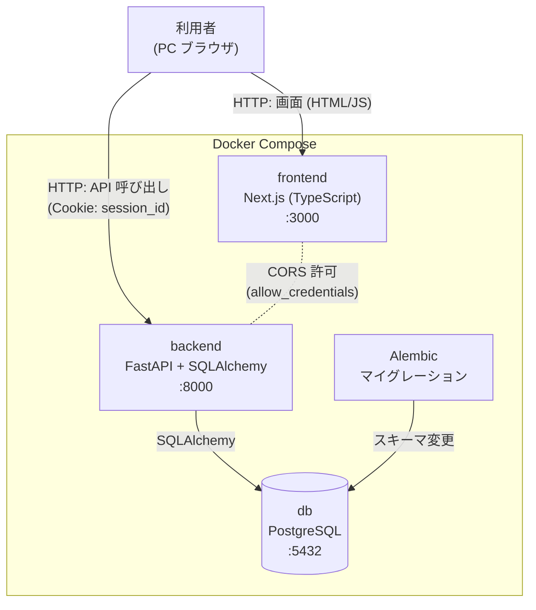

図 1　システム構成図

## 2.3 ディレクトリ構成案 [補完]

学習しやすいよう、バックエンドは「Router (入口) → Service (業務ルール) → Model (DB)」の 3 層に分けます (詳細は 7.7 節のクラス図)。

```
soccer-app/
├─ docker-compose.yml
├─ .env.example
├─ docs/                  # 本仕様書など
├─ frontend/              # Next.js (TypeScript)
│  └─ app/
│     ├─ signup/ login/ teams/ invite/[token]/
│     └─ teams/[teamId]/ (events, members, invitations, ...)
└─ backend/
   ├─ main.py             # 既存: アプリ生成、CORS、ルーター登録
   ├─ app/
   │  ├─ core/            # config.py(設定) security.py(ハッシュ・トークン)
   │  ├─ db.py            # エンジン・セッション・Base (制約の命名規約を含む)
   │  ├─ models/          # SQLAlchemy モデル (users, teams, ...)
   │  ├─ schemas/         # Pydantic (リクエスト/レスポンス)
   │  ├─ routers/         # auth.py teams.py members.py invitations.py events.py ...
   │  ├─ services/        # 業務ルール (退会、招待、出欠、会費 ...)
   │  ├─ deps.py          # get_current_user / get_team_context / require_admin
   │  └─ errors.py        # 共通エラー (AppError) と例外ハンドラ
   ├─ alembic/            # マイグレーション
   └─ tests/              # pytest
```

## 2.4 Docker Compose と環境変数

| **サービス** | **イメージ / 実行** | **ポート** | **備考** |
|---|---|---|---|
| db | postgres (18 系) | 5432 | ボリュームでデータを永続化する。 |
| backend | FastAPI (uvicorn) | 8000 | 起動時に alembic upgrade head を実行する (compose の command)。 |
| frontend | Next.js (dev サーバー) | 3000 | API の URL は環境変数で渡す。 |

| **環境変数** | **例** | **意味** |
|---|---|---|
| DATABASE_URL | postgresql+psycopg://app:pw@db:5432/soccer | DB 接続先 |
| FRONTEND_ORIGIN | http://localhost:3000 | CORS の許可元、および CSRF 対策で Origin を照合する相手 |
| COOKIE_SECURE | false (開発) / true (本番 HTTPS) | Cookie の Secure 属性 |
| SESSION_TTL_DAYS | 14 | セッションの有効日数 (最終利用から) |
| INVITATION_TTL_DAYS | 7 | 招待リンクの有効日数 |

# 3. 基本方針と設計判断

## 3.1 基本方針

- 認証は **メールアドレス + パスワード** のみ。最初から実装する。
- 1 人のユーザーは **複数チームに所属できる**。
- 権限は「ユーザー」ではなく **「チーム内での役割」** で決める。同じ人がチームごとに異なる役割を持てる。
- 役割は **幹事 (admin)** と **選手 (member)** の 2 種類。幹事は 1 チームに複数人いてよい。
- 同じチームのメンバーは同じ画面を見る。役割によって操作ボタンや管理画面の表示が変わる。
- 会費は決済機能を持たず、**収支の記録 (帳簿)** として管理する。

## 3.2 設計判断の一覧

| **#** | **項目** | **決めたこと** | **理由** |
|---|---|---|---|
| D1 | 退会の扱い [決定] | team_members.left_at を持たせる論理的な退会。物理削除しない。 | 過去の出欠・成績・会費を残すため。フェーズ 2 の集計とも相性が良い。 |
| D2 | 認証方式 [決定] | サーバー側セッション (DB 保存) + httpOnly Cookie。 | ログアウトや強制失効が確実。仕組みを学ぶ目的に合う。 |
| D3 | 招待リンク [決定] | 複数人利用可、発行から 7 日、人数上限なし、幹事が無効化。 | グループ LINE に 1 本貼れば全員が使える運用に合う。 |
| D4 | パスワード [採用案] | argon2id。8〜128 文字。平文は保存もログ出力もしない。 | 現在推奨されるハッシュ方式。bcrypt の 72 バイト制限もない。 |
| D5 | 時刻 [暫定] | DB は UTC の timestamptz。表示と「今日」の判定は JST。 | 国内チーム前提で単純にするため。 |
| D6 | 在籍判定 | すべての所属判定に left_at IS NULL を付ける。判定は 1 か所の関数に集約。 | 付け忘れによる退会者のアクセスを防ぐ。 |
| D7 | 存在の隠蔽 | 所属していないチームのデータは 403 ではなく 404。 | チームやデータの存在を推測させないため。 |
| D8 | 金額 | 整数 (円)。小数・浮動小数点は使わない。 | 丸め誤差を避ける。 |
| D9 | ID | bigint の連番。 | 仕様どおり。連番でも、チーム所属の検査で守る。 |
| D10 | enum の実装 [補完] | DB では文字列 + CHECK 制約 (SQLAlchemy の native_enum=False)。 | PostgreSQL の ENUM は値の追加・変更のマイグレーションが面倒なため。 |
| D11 | エラー形式 [補完] | {"error": {"code", "message"}} に統一。 | フロントで扱いやすく、テストしやすい。 |
| D12 | 繰り返し日程 [採用案] | フェーズ 1〜3 に含めない。 | MVP を軽く保つ。 |
| D13 | 主キーの形 [決定] | team_members は複合主キー (user_id, team_id)。attendances は代理キー id + UNIQUE (event_id, user_id)。 | team_members は参照する外部キーがなく複合主キーで足りる。attendances はフェーズ 3 で user_id を NULL 可にするため、主キーに user_id を含められない。 |
| D14 | 制約・索引の名前 [補完] | Base の MetaData に命名規約 (pk_/uq_/ck_/fk_/ix_) を設定する。 | 名前なしの制約があると Alembic の downgrade で制約を指定できないため。 |

# 4. ユーザーの流れと権限

## 4.1 ログイン後の流れ

| **状態** | **遷移先** |
|---|---|
| **所属チームなし** | /teams で「チームを作る」または「招待リンクで参加」の案内を表示する。 |
| **所属チーム 1 つ** | そのチームのホーム /teams/{team_id} へ直行する。 |
| **所属チーム 2 つ以上** | チーム選択画面 /teams を表示し、選んだチームのホームへ進む。 |

チーム内の URL は /teams/{team_id}/... です。API は毎回「ログインユーザーがそのチームの在籍メンバーか」「役割は何か」を検査します。

## 4.2 役割

| **役割** | **値** | **説明** |
|---|---|---|
| 幹事 | admin | 日程・メンバー・招待・会費・成績・お知らせなど、管理操作ができる。1 チームに複数人いてよい。 |
| 選手 | member | 閲覧と、自分の出欠回答ができる。自分の脱退もできる。 |

## 4.3 権限表

| **機能** | **選手** | **幹事** | **フェーズ** |
|---|---|---|---|
| 日程・出欠の閲覧 | ○ | ○ | 1 |
| 自分の出欠回答 (締切前) | ○ | ○ | 1 |
| 日程の作成・編集・削除 | × | ○ | 1 |
| 他メンバーの出欠の代理入力・締切後の変更 | × | ○ | 1 |
| メンバーの招待・役割変更・退会処理 | × | ○ | 1 |
| 試合結果・成績の閲覧 | ○ | ○ | 2 |
| 試合結果・成績の登録 | × | ○ | 2 |
| 自分の会費の支払い状況の閲覧 | ○ | ○ | 2 |
| 収支・全員の会費の管理 | × | ○ | 2 |
| お知らせの閲覧 | ○ | ○ | 3 |
| お知らせの投稿 | × | ○ | 3 |
| 助っ人 (ゲスト) の追加・出欠入力 | × | ○ | 3 |
| フォーメーションボードの閲覧 [補完] | ○ | ○ | 3 |
| フォーメーションボードの編集 [補完] | × | ○ | 3 |

補足: 選手も、自分自身の脱退 (退会処理) は行えます。

## 4.4 制約

- チームには**常に 1 人以上の幹事**がいる。最後の幹事は、降格も退会もできない。
- チームを作ったユーザーは最初の幹事になる。
- 自分が所属していない (または退会した) チームのデータは、存在も分からないようにする。**403 ではなく 404 を返す**。

## 4.5 権限チェックの順序

API は、次の順序で検査します。どの段階で落ちたかによって返す状態コードが決まります。この順序を守ると、「他人のチームの存在が漏れない」「役割の違いを正しく伝えられる」の両方を満たせます。

| **順** | **検査** | **失敗時** | **実装の場所** |
|---|---|---|---|
| 1 | ログイン済みか (有効なセッションがあるか) | 401 UNAUTHENTICATED | get_current_user |
| 2 | そのチームの 在籍メンバーか (left_at IS NULL) | 404 NOT_FOUND (存在を隠す) | get_team_context |
| 3 | その操作に必要な役割か (幹事専用 API など) | 403 FORBIDDEN | require_admin |
| 4 | 対象リソース (日程・請求・招待など) が そのチームのものか | 404 NOT_FOUND | Service (team_id を条件に含めて取得) |
| 5 | 業務ルール (締切、最後の幹事、重複など) | 403 / 409 / 410 / 422 | Service |

> **やさしい解説: なぜ 4 番で「そのチームのもの」まで見るのか**
>
> たとえば /teams/5/events/9 で、日程 9 が実はチーム 7 のものだったとします。チーム 5 のメンバーであることだけを確認して日程 9 を返すと、他チームのデータが見えてしまいます (IDOR という典型的な脆弱性です)。
>
> そのため、日程は必ず「id = 9 かつ team_id = 5」の条件で取得し、見つからなければ 404 にします。ID は連番なので、推測されても守れる作りにしておきます。

# 5. 機能一覧

機能 ID ごとに、権限・関連する画面と API を対応付けた一覧です。作業の分割や進捗管理にも使えます。画面名は第 6 章、API は第 8 章を参照してください。

## 5.1 フェーズ 1 (MVP)

| **ID** | **機能** | **権限** | **画面** | **主な API** |
|---|---|---|---|---|
| F-101 | ユーザー登録 | 公開 | /signup | POST /auth/signup |
| F-102 | ログイン・ログアウト | 公開 / ログイン | /login | POST /auth/login, /auth/logout, GET /me |
| F-103 | チーム作成 (作成者は幹事) | ログイン | /teams/new | POST /teams |
| F-104 | チーム選択 | ログイン | /teams | GET /teams |
| F-105 | 招待リンクの発行・一覧・無効化 | 幹事 | /teams/{id}/invitations | POST/GET/DELETE /teams/{id}/invitations |
| F-106 | 招待リンクで参加 | ログイン | /invite/{token} | GET /invitations/{token}, POST .../accept |
| F-107 | メンバー一覧 | メンバー | /teams/{id}/members | GET /teams/{id}/members |
| F-108 | 役割変更 | 幹事 | /teams/{id}/members | PATCH /teams/{id}/members/{uid} |
| F-109 | 退会処理・自分の脱退 | 幹事 / 本人 | /teams/{id}/members | DELETE /teams/{id}/members/{uid} |
| F-110 | 日程の作成・編集・削除 | 幹事 | /teams/{id}/events/new ほか | POST/PATCH/DELETE /teams/{id}/events |
| F-111 | 日程の一覧・詳細 | メンバー | /teams/{id}/events, 日程詳細 | GET /teams/{id}/events, .../{eid} |
| F-112 | 出欠回答 (締切つき) | 本人 (締切前) / 幹事 | 日程詳細 | PUT .../attendances/{uid} |
| F-113 | チームホーム (直近の日程と自分の出欠) | メンバー | /teams/{id} | GET /teams/{id}, GET .../events |

## 5.2 フェーズ 2

| **ID** | **機能** | **権限** | **画面** | **主な API** |
|---|---|---|---|---|
| F-201 | 会費請求の作成 | 幹事 | /teams/{id}/fees/new | POST .../fee-charges |
| F-202 | 請求一覧・詳細・入金管理 | 幹事 | /teams/{id}/fees, /fees/{cid} | GET/PATCH/DELETE .../fee-charges |
| F-203 | 自分の会費の確認 | メンバー | /teams/{id}/my-fees | GET .../me/fees |
| F-204 | 収支帳簿 (一覧・追加・修正・集計) | 幹事 | /teams/{id}/ledger | GET/POST/PATCH/DELETE .../ledger-entries |
| F-205 | 試合結果の登録・編集・削除 | 幹事 (閲覧は全員) | 日程詳細, result/edit | GET/PUT/DELETE .../events/{eid}/match |
| F-206 | 成績 (チーム戦績・得点ランキング・出場回数) | メンバー | /teams/{id}/stats | GET .../stats/team, .../stats/players |

## 5.3 フェーズ 3

| **ID** | **機能** | **権限** | **画面** | **主な API** |
|---|---|---|---|---|
| F-301 | お知らせの閲覧 | メンバー | /teams/{id}/announcements ほか | GET .../announcements |
| F-302 | お知らせの投稿・編集・削除 | 幹事 | /teams/{id}/announcements/new ほか | POST/PATCH/DELETE .../announcements |
| F-303 | 助っ人 (ゲスト) の管理 | 幹事 | /teams/{id}/guests | GET/POST/PATCH/DELETE .../guests |
| F-304 | 助っ人の出欠入力 | 幹事 | 日程詳細 | PUT/DELETE .../guest-attendances/{gid} |
| F-305 | スタメン / フォーメーションボード | 閲覧: 全員 / 編集: 幹事 | .../events/{eid}/board | GET/PUT/DELETE .../events/{eid}/board |

# 6. 画面仕様

## 6.1 共通仕様

| **項目** | **内容** |
|---|---|
| **共通レイアウト** | ヘッダ: アプリ名、チーム名 (複数所属ならチーム切替)、ユーザー名、ログアウト。<br>チーム内はサイドナビを表示する。 |
| **ナビ項目** | ホーム / 日程 / メンバー ... 全員<br>[2] 自分の会費 / 成績 ... 全員、会費請求 / 収支帳簿 ... 幹事<br>[3] お知らせ ... 全員、助っ人 ... 幹事<br>幹事専用の項目 (招待リンクなど) は選手には表示しない。ただし表示の有無はあくまで利便性で、実際の保護は API 側の権限チェックで行う。 |
| **日時の表示** | 2026/11/21(土) 09:00 の形式、日本時間 (JST) 固定。入力も JST で受け付け、送信時に UTC に変換する。 |
| **金額の表示** | 1,000 円 のように 3 桁区切り。内部は整数 (円)。 |
| **未ログイン** | ログインが必要な画面を開くと /login?next=<元のパス> へ移動し、ログイン後に元の画面へ戻す。 |
| **セッション切れ** | API が 401 を返したら、同様にログイン画面へ移動する。 |
| **404 画面** | 存在しない画面、所属していないチームの画面、退会したチームの画面はすべて同じ「ページが見つかりません」を表示する。 |
| **403 表示** | 選手が幹事専用の画面を開いたとき「この操作は幹事のみ可能です」を表示する。 |
| **確認ダイアログ** | 削除・退会・無効化など、取り消しにくい操作の前に必ず表示する。 |
| **エラー表示** | API のエラーは error.message を画面に表示する。入力エラー (422) は該当項目の下に表示する。 |
| **二重送信** | 送信中はボタンを無効にする。 |

## 6.2 フェーズ 1 の画面一覧

| **画面** | **パス** | **内容** | **権限** |
|---|---|---|---|
| ユーザー登録 | /signup | 名前・メール・パスワード | 未ログイン |
| ログイン | /login | メール・パスワード | 未ログイン |
| チーム選択 | /teams | 所属チーム一覧、チーム作成への導線 | ログイン |
| チーム作成 | /teams/new | チーム名を入力 | ログイン |
| 招待リンクで参加 | /invite/{token} | チーム名を確認して参加 | ログイン |
| チームホーム | /teams/{id} | 直近の日程と自分の出欠状況 | メンバー |
| 日程一覧 | /teams/{id}/events | 日程の一覧、出欠の回答状況 | メンバー |
| 日程詳細 | /teams/{id}/events/{eid} | 出欠回答、参加者一覧と集計 | メンバー |
| 日程作成・編集 | /teams/{id}/events/new ほか | 種別・日時・場所・締切を入力 | 幹事 |
| メンバー一覧 | /teams/{id}/members | 一覧。幹事は役割変更・退会処理 | メンバー (操作は幹事) |
| 招待リンク管理 | /teams/{id}/invitations | 招待リンクの発行・無効化 | 幹事 |

## 6.3 フェーズ 1 の画面遷移

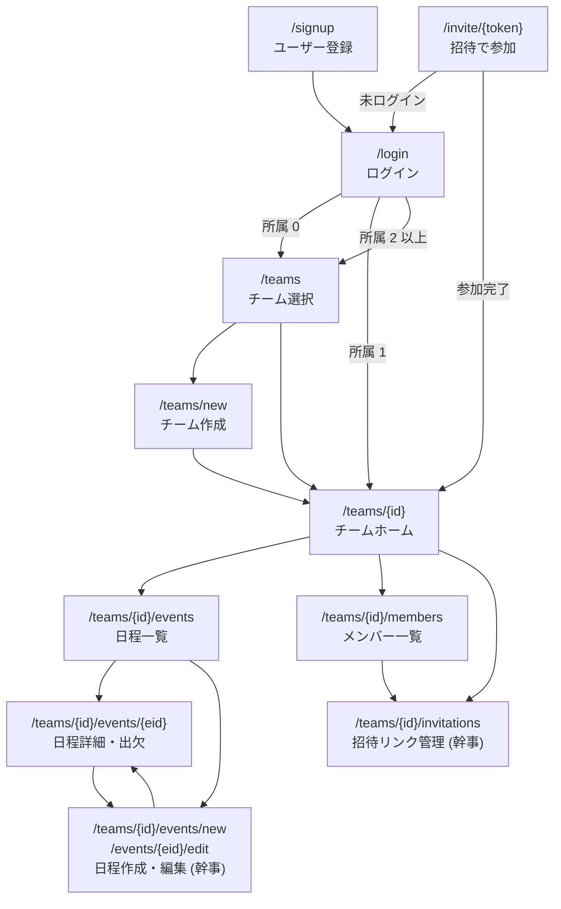

図 2　フェーズ 1 の画面遷移図

## 6.4 フェーズ 1 の画面詳細

### 6.4.1 ユーザー登録

| | |
|---|---|
| **パス** | /signup |
| **権限** | 未ログイン |
| **概要** | 新しいアカウントを作る。登録に成功すると、そのままログイン状態になる。 |
| **入力** | - 名前: 必須、1〜50 文字 (保存時に前後の空白を除く)<br>- メールアドレス: 必須、メール形式、254 文字以内 (保存時に前後の空白を除き小文字にする)<br>- パスワード: 必須、8〜128 文字 |
| **操作** | 「登録」→ POST /auth/signup。成功したら next があればそこへ、なければ /teams へ移動する。「ログインはこちら」→ /login。 |
| **エラー** | メール重複 (409) は「このメールアドレスは登録済みです」をメール欄の下に表示する。 |
| **備考** | ログイン済みで開いたら /teams へ移動する。 |

### 6.4.2 ログイン

| | |
|---|---|
| **パス** | /login |
| **権限** | 未ログイン |
| **概要** | メールアドレスとパスワードでログインする。 |
| **入力** | - メールアドレス: 必須<br>- パスワード: 必須 |
| **操作** | 「ログイン」→ POST /auth/login。成功後は next があればそこへ。なければ所属チーム数で分岐する (0 → /teams、1 → /teams/{id}、2 以上 → /teams)。 |
| **エラー** | 認証失敗 (401) は「メールかパスワードが違います」とだけ表示する。どちらが違うかは示さない。 |
| **備考** | 「新規登録はこちら」→ /signup。ログイン済みで開いたら /teams へ移動する。 |

### 6.4.3 チーム選択

| | |
|---|---|
| **パス** | /teams |
| **権限** | ログイン |
| **概要** | 自分が所属しているチームの一覧。チーム作成と招待リンクでの参加の入口。 |
| **表示** | - 所属チームの一覧 (チーム名、自分の役割バッジ「幹事」「選手」)。チーム名順。<br>- 所属 0 件のときは「チームを作る」または「招待リンクで参加」の案内を表示する。 |
| **操作** | - チーム名をクリック → /teams/{id}。<br>- 「チームを作る」→ /teams/new。<br>- 招待リンクの URL を貼る入力欄と「参加画面へ」ボタン → /invite/{token} へ移動する。 |
| **使う API** | GET /teams |
| **備考** | 所属が 1 つでも、この画面を直接開けば一覧を表示する (自動遷移はログイン直後のみ)。 |

### 6.4.4 チーム作成

| | |
|---|---|
| **パス** | /teams/new |
| **権限** | ログイン |
| **概要** | チームを新しく作る。作った人が最初の幹事になる。 |
| **入力** | - チーム名: 必須、1〜50 文字 |
| **操作** | 「作成」→ POST /teams。成功したら /teams/{id} へ移動する。 |

### 6.4.5 招待リンクで参加

| | |
|---|---|
| **パス** | /invite/{token} |
| **権限** | ログイン (未ログインは /login?next=... へ) |
| **概要** | 招待先のチーム名を確認して参加する。 |
| **表示** | - 有効: 「◯◯ に参加しますか?」と「参加する」ボタン。<br>- すでに在籍中: 「このチームにはすでに参加しています」と「チームホームへ」ボタン。<br>- 期限切れ・無効化済み (410): 「この招待リンクは使えません。幹事に新しいリンクを依頼してください」。<br>- 存在しないトークン (404): 「ページが見つかりません」。 |
| **操作** | 「参加する」→ POST /invitations/{token}/accept。成功したら /teams/{team_id} へ移動する。 |
| **使う API** | GET /invitations/{token}、POST /invitations/{token}/accept |
| **備考** | 以前このチームを退会した人も同じ画面から再参加できる (選手として復帰)。 |

### 6.4.6 チームホーム

| | |
|---|---|
| **パス** | /teams/{id} |
| **権限** | メンバー |
| **概要** | 直近の日程と、自分の出欠状況を一目で確認する入口。 |
| **表示** | - チーム名と自分の役割。<br>- 「直近の日程」: 開始日時が現在以降のものを開始順に最大 5 件。種別バッジ、タイトル、日時、場所、**自分の出欠** (○ △ × / 未回答)、回答締切の状態 (締切間近・締切済み)。<br>- 「未回答で締切前」の日程は目立たせる。 |
| **操作** | 日程をクリック → 日程詳細。「日程一覧を見る」。幹事には「日程を作る」を表示する。 |
| **使う API** | GET /teams/{id}、GET /teams/{id}/events?limit=5 |
| **備考** | フェーズ 2・3 で表示が増える (6.7 節)。 |

### 6.4.7 日程一覧

| | |
|---|---|
| **パス** | /teams/{id}/events |
| **権限** | メンバー |
| **概要** | 日程の一覧と、それぞれの出欠の回答状況。 |
| **表示** | - 1 行 = 種別、タイトル、日時、場所、自分の出欠、回答状況 (○ n / △ n / × n / 未回答 n)、締切。<br>- 既定は「今後」の日程を開始日時の昇順。「過去」「期間指定 (月)」に切り替えられる (過去は新しい順)。<br>- 50 件ずつ (ページング)。 |
| **操作** | 行をクリック → 日程詳細。幹事には「日程を作る」を表示する。 |
| **使う API** | GET /teams/{id}/events?from=&to=&order=&limit=&offset= |

### 6.4.8 日程詳細

| | |
|---|---|
| **パス** | /teams/{id}/events/{eid} |
| **権限** | メンバー |
| **概要** | 日程の内容、自分の出欠回答、参加者の一覧と集計。 |
| **表示** | - 種別・タイトル・日時・場所・メモ。<br>- 回答締切 (締切済みかどうか。未設定なら「締切なし」)。<br>- 集計: ○ n 人 / △ n 人 / × n 人 / 未回答 n 人。<br>- 参加者一覧: ○ △ × ごとに名前とコメント。未回答者の名前一覧。<br>- 退会済みの人が過去にした回答には「退会済み」バッジを付ける。<br>- 幹事が代理入力した行は「幹事が入力」と表示する (updated_by が本人でない)。 |
| **自分の出欠** | ○ △ × のボタンとコメント欄 (任意、200 文字以内)、「回答する」。締切後は選手には無効化し、理由を表示する (幹事は締切後も変更できる)。 |
| **幹事の操作** | - 各メンバーの行から「代理入力」(○ △ × とコメント)。<br>- 「編集」→ 日程編集画面、「削除」→ 確認ダイアログ (出欠も一緒に消える旨を表示)。 |
| **使う API** | GET /teams/{id}/events/{eid}、PUT /teams/{id}/events/{eid}/attendances/{uid}、DELETE /teams/{id}/events/{eid} |

### 6.4.9 日程作成・編集

| | |
|---|---|
| **パス** | /teams/{id}/events/new , /teams/{id}/events/{eid}/edit |
| **権限** | 幹事 |
| **概要** | 日程の新規作成と編集。同じフォームを使う。 |
| **入力** | - 種別: 必須 (試合 / 練習 / その他)<br>- タイトル: 必須、1〜100 文字<br>- 開始日時: 必須 (JST)<br>- 終了日時: 任意。開始日時より後であること<br>- 場所: 任意、200 文字以内<br>- メモ: 任意、2000 文字以内<br>- 出欠の締切: 任意。開始日時以前であること。空欄なら締切なし |
| **操作** | 「保存」→ 作成は POST、編集は PATCH。成功したら日程詳細へ移動する。「キャンセル」で戻る。 |
| **備考** | 選手が URL を直接開いた場合は 403 表示にする。 |

### 6.4.10 メンバー一覧

| | |
|---|---|
| **パス** | /teams/{id}/members |
| **権限** | メンバー (操作は幹事) |
| **概要** | チームのメンバー一覧。幹事は役割変更と退会処理ができる。 |
| **表示** | - 名前、役割、参加日。幹事にだけメールアドレスも表示する。<br>- 幹事には「退会済みも表示」のスイッチを表示する (include_left=true)。退会済みは薄く表示し、退会日を付ける。 |
| **幹事の操作** | - 役割変更 (昇格 / 降格)。最後の幹事の降格は押せない (理由を表示)。<br>- 退会処理。確認ダイアログ:「◯◯ さんを退会させますか? 過去の出欠などの履歴は残ります」。最後の幹事は押せない。 |
| **全員の操作** | 自分の行に「このチームを脱退する」を表示する。確認後 DELETE → /teams へ移動する。最後の幹事は押せない (理由を表示)。 |
| **使う API** | GET /teams/{id}/members、PATCH / DELETE /teams/{id}/members/{uid} |

### 6.4.11 招待リンク管理

| | |
|---|---|
| **パス** | /teams/{id}/invitations |
| **権限** | 幹事 |
| **概要** | 招待リンクの発行、確認、無効化。 |
| **表示** | - 一覧 (新しい順): 作成日時、作成者、有効期限、状態 (有効 / 期限切れ / 無効化済み)。<br>- 有効なリンクには URL を表示し、「コピー」ボタンを付ける。<br>- 説明文:「リンクは複数人が使えます。有効期限は発行から 7 日です。」 |
| **操作** | - 「招待リンクを発行」→ 一覧に追加し、URL を表示する。<br>- 「無効化」→ 確認ダイアログ。無効化しても、すでに参加した人には影響しない。 |
| **使う API** | POST / GET /teams/{id}/invitations、DELETE /teams/{id}/invitations/{iid} |

## 6.5 フェーズ 2 の画面

| **画面** | **パス** | **内容** | **権限** |
|---|---|---|---|
| 自分の会費 | /teams/{id}/my-fees | 自分宛ての請求と支払い状況 | メンバー |
| 会費請求一覧 | /teams/{id}/fees | 請求の一覧と入金状況 | 幹事 |
| 会費請求作成 | /teams/{id}/fees/new | 請求の作成 | 幹事 |
| 会費請求詳細 | /teams/{id}/fees/{cid} | メンバー別の入金管理 | 幹事 |
| 収支帳簿 | /teams/{id}/ledger | 収入・支出の一覧、追加、集計 | 幹事 |
| 試合結果の登録・編集 | /teams/{id}/events/{eid}/result/edit | 試合結果、出場者、得点者 | 幹事 (閲覧は日程詳細で全員) |
| 成績 | /teams/{id}/stats | チーム戦績、得点ランキング、出場回数 | メンバー |

### 6.5.1 自分の会費

| | |
|---|---|
| **パス** | /teams/{id}/my-fees |
| **権限** | メンバー |
| **概要** | 自分宛ての請求と、支払い状況を確認する (閲覧のみ)。 |
| **表示** | - 未払いの合計額。<br>- 請求の一覧: 請求名、金額、支払期限、状態 (未払い / 入金済み + 入金日)。未払いを上、入金済みを下に並べる。 |
| **備考** | 支払いはアプリの外で行い、幹事が入金済みにする旨の説明文を表示する。 |
| **使う API** | GET /teams/{id}/me/fees |

### 6.5.2 会費請求一覧

| | |
|---|---|
| **パス** | /teams/{id}/fees |
| **権限** | 幹事 |
| **概要** | 作成した請求の一覧。 |
| **表示** | 請求名、1 人あたり金額、支払期限、関連日程、入金 x / y 人、未払い合計額。新しい順。 |
| **操作** | 「請求を作る」→ 作成画面。行をクリック → 請求詳細。 |
| **使う API** | GET /teams/{id}/fee-charges |

### 6.5.3 会費請求作成

| | |
|---|---|
| **パス** | /teams/{id}/fees/new |
| **権限** | 幹事 |
| **概要** | 「11 月分会費 1,000 円」「○/○ のコート代割り勘」などの請求を作る。 |
| **入力** | - 請求名: 必須、1〜100 文字<br>- 1 人あたり金額: 必須、1〜1,000,000 の整数 (円)<br>- 支払期限: 任意 (日付)<br>- 関連する日程: 任意 (一覧から選択)<br>- メモ: 任意、500 文字以内<br>- 対象メンバー: 在籍メンバーのチェックボックス。既定は全員。全選択 / 全解除ができる。1 人以上必須 |
| **操作** | 「作成」→ POST /teams/{id}/fee-charges。成功したら請求詳細へ移動する。 |
| **備考** | 割り勘は、幹事が金額を計算して入力する (自動計算はしない)。作成後に対象メンバーの金額は変えられない。 |

### 6.5.4 会費請求詳細

| | |
|---|---|
| **パス** | /teams/{id}/fees/{cid} |
| **権限** | 幹事 |
| **概要** | メンバーごとの入金を管理する。 |
| **表示** | - 請求情報 (請求名、金額、期限、関連日程、メモ)。請求名・期限・メモは編集できる。<br>- 集計: 入金済み x / y 人、入金額、未払い額。<br>- メンバー別の表: 名前 (退会済みバッジ)、金額、状態、入金日、操作。 |
| **操作** | - 「入金済みにする」: 入金日を選択 (既定は今日)。帳簿に収入が自動で記録される。<br>- 「未払いに戻す」: 自動記録した収入を取り消す (削除する)。<br>- 「請求を削除」: 入金済みが 1 件でもあれば不可 (理由を表示)。 |
| **使う API** | GET / PATCH / DELETE /teams/{id}/fee-charges/{cid}、PATCH .../fee-charges/{cid}/members/{uid} |

### 6.5.5 収支帳簿

| | |
|---|---|
| **パス** | /teams/{id}/ledger |
| **権限** | 幹事 |
| **概要** | 収入と支出の記録を管理する。 |
| **表示** | - 絞り込み: 期間、種別 (収入 / 支出)、カテゴリ。<br>- 集計: 絞り込み結果の収入合計・支出合計・差引、およびチームの現在残高。<br>- 一覧: 発生日、種別、カテゴリ、金額、メモ、関連日程、入力者。新しい順。50 件ずつ。 |
| **操作** | - 「追加」→ 入力フォーム: 種別、金額 (1 以上の整数)、カテゴリ (会費 / コート代 / 備品 / その他)、発生日、メモ、関連日程。<br>- 行の「修正」「削除」。ただし**会費の入金から自動で作られた行**は「会費入金による自動記録」と表示し、ここでは修正・削除できない (請求詳細で未払いに戻す)。 |
| **使う API** | GET / POST /teams/{id}/ledger-entries、PATCH / DELETE .../ledger-entries/{id}、GET .../ledger-summary |

### 6.5.6 試合結果 (閲覧と登録・編集)

| | |
|---|---|
| **パス** | /teams/{id}/events/{eid}/result/edit |
| **権限** | 幹事 (閲覧は日程詳細で全員) |
| **概要** | 種別が「試合」の日程に、結果を 1 対 1 で登録する。 |
| **閲覧 (日程詳細内)** | 結果が登録済みの試合には「結果」欄を表示する: 対戦相手、スコア (自チーム - 相手)、勝・分・負、出場者、得点者 / アシスト。未登録なら「結果は未登録です」(幹事には登録ボタン)。 |
| **入力** | - 対戦相手: 必須、1〜100 文字<br>- 自チーム得点 / 相手得点: 必須、0 以上の整数<br>- 出場者: 在籍メンバーのチェックボックス。**出欠が ○ の人を初期チェック**にするが、変更できる (急きょ参加などがあるため)<br>- 得点: 行を追加して、得点者 (出場者から選択)、アシスト (任意・出場者から選択、得点者と別人)、時間 (分・任意)<br>- メモ: 任意、1000 文字以内 |
| **検証** | 得点の記録数が自チーム得点を超えてはいけない (オウンゴールなど、記録しない得点があるため「以下」)。 |
| **操作** | 「保存」→ PUT。「結果を削除」→ 確認後 DELETE。 |
| **使う API** | GET / PUT / DELETE /teams/{id}/events/{eid}/match |

### 6.5.7 成績

| | |
|---|---|
| **パス** | /teams/{id}/stats |
| **権限** | メンバー |
| **概要** | チームの戦績と、選手の得点・出場回数を見る。 |
| **表示** | - 絞り込み: 年 (既定は今年、「すべて」も選べる)。<br>- チーム戦績: 試合数、勝・分・負、総得点、総失点。<br>- 選手別の表: 順位 (得点順、同数は同順位)、名前、得点、アシスト、出場回数。出場回数でも並べ替えられる。<br>- 退会済みの選手には「退会済み」バッジを付けて表示する。 |
| **使う API** | GET /teams/{id}/stats/team?year=、GET /teams/{id}/stats/players?year= |

## 6.6 フェーズ 3 の画面

| **画面** | **パス** | **内容** | **権限** |
|---|---|---|---|
| お知らせ一覧 | /teams/{id}/announcements | お知らせの一覧 | メンバー |
| お知らせ詳細 | /teams/{id}/announcements/{aid} | 本文の表示 | メンバー |
| お知らせ作成・編集 | /teams/{id}/announcements/new ほか | 投稿・編集 | 幹事 |
| 助っ人管理 | /teams/{id}/guests | 助っ人の登録・編集・削除 | 幹事 |
| フォーメーションボード | /teams/{id}/events/{eid}/board | 試合のスタメン配置 | メンバー (編集は幹事) |

### 画面遷移 (フェーズ 2・3)

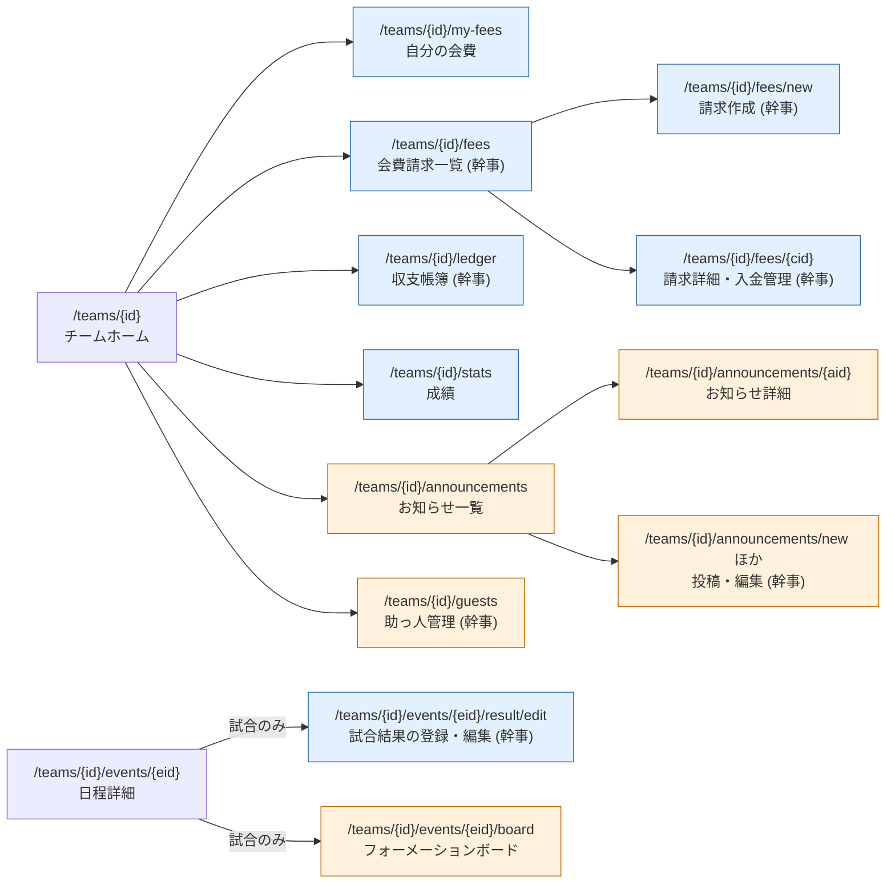

図 3　フェーズ 2・3 の画面遷移図 (青: フェーズ 2、橙: フェーズ 3)

### 6.6.1 お知らせ一覧・詳細

| | |
|---|---|
| **パス** | /teams/{id}/announcements , /teams/{id}/announcements/{aid} |
| **権限** | メンバー |
| **概要** | チーム全員向けのお知らせを見る。 |
| **一覧** | ピン留めを先頭に、新しい順。タイトル、投稿日、本文の冒頭 (50 文字)。幹事には「投稿」ボタン。 |
| **詳細** | タイトル、本文 (プレーンテキスト。改行は保持)、投稿者、投稿日時、更新日時。幹事には「編集」「削除」「ピン留め切替」。 |
| **備考** | 本文は HTML として解釈せず、テキストとして表示する (XSS 対策)。 |
| **使う API** | GET /teams/{id}/announcements、GET .../announcements/{aid} |

### 6.6.2 お知らせ作成・編集

| | |
|---|---|
| **パス** | /teams/{id}/announcements/new , /teams/{id}/announcements/{aid}/edit |
| **権限** | 幹事 |
| **概要** | お知らせを投稿・編集する。 |
| **入力** | - タイトル: 必須、1〜100 文字<br>- 本文: 必須、1〜5000 文字<br>- ピン留め: チェックボックス (既定オフ) |
| **操作** | 「保存」→ 作成は POST、編集は PATCH。成功したら詳細へ移動する。 |

### 6.6.3 助っ人管理

| | |
|---|---|
| **パス** | /teams/{id}/guests |
| **権限** | 幹事 |
| **概要** | アカウントを持たない参加者 (助っ人) を登録・管理する。 |
| **表示** | 助っ人の一覧 (名前、メモ、登録日)。 |
| **操作** | - 「追加」: 名前 (必須、1〜50 文字)、メモ (任意、200 文字以内)。<br>- 「編集」。<br>- 「削除」: 出欠やフォーメーションに使われている助っ人は削除できない (理由を表示)。 |
| **日程詳細での追加** | 日程詳細で「助っ人を追加」→ 登録済みの助っ人を選ぶ、または新規登録 → 出欠 (○ △ ×) を入力する。参加者一覧に「助っ人」バッジ付きで表示され、○ の合計には助っ人も含めて表示する。 |
| **使う API** | GET / POST /teams/{id}/guests、PATCH / DELETE .../guests/{gid}、PUT / DELETE .../events/{eid}/guest-attendances/{gid} |

### 6.6.4 フォーメーションボード

| | |
|---|---|
| **パス** | /teams/{id}/events/{eid}/board |
| **権限** | メンバー (編集は幹事) |
| **概要** | 試合ごとに、スタメンとベンチ、ピッチ上の配置を保存・共有する。種別が「試合」の日程のみ。 |
| **表示** | - ピッチの図 (サッカー / フットサルを切替)。選手を丸いマーカーで表示する。<br>- 候補リスト: 出欠が ○ または △ の選手と、○ の助っ人。<br>- フォーメーション名 (例: 4-4-2)、メモ。 |
| **幹事の操作** | - 候補をピッチへドラッグして配置 = スタメン。ピッチ外のリストに置く = ベンチ。<br>- スタメン人数の上限: サッカー 11 人、フットサル 5 人。<br>- 「保存」→ PUT。「ボードを削除」→ DELETE。 |
| **座標** | ピッチを横 100 × 縦 100 とした割合 (0〜100) で保存する。原点は左上。 |
| **備考** | 選手の閲覧画面ではドラッグ操作を無効にする。 |
| **使う API** | GET / PUT / DELETE /teams/{id}/events/{eid}/board |

## 6.7 既存画面への追加 (フェーズ 2・3)

| **画面** | **追加される表示・操作** | **フェーズ** |
|---|---|---|
| チームホーム | 自分の未払い会費があれば注意表示 (自分の会費へのリンク)。直近の試合結果。 | 2 |
| チームホーム | お知らせの最新 3 件 (ピン留め優先)。 | 3 |
| 日程詳細 (試合) | 結果欄 (閲覧・幹事は登録 / 編集)。 | 2 |
| 日程詳細 (試合) | フォーメーションボードへのリンク。 | 3 |
| 日程詳細 | 助っ人の追加と出欠入力 (幹事)、参加者一覧への助っ人表示、○ の合計。 | 3 |
| 日程編集 | 結果が登録済みの日程は、種別を「試合」から変更できない。日程削除も結果を先に削除する必要がある。 | 2 |
| メンバー一覧 | 退会処理の確認文に「未払いの請求は残ります」を追加 (未払いがある場合のみ)。 | 2 |

# 7. データモデル

## 7.0 テーブル一覧と共通ルール

| **テーブル** | **役割** | **フェーズ** |
|---|---|---|
| users | ユーザー (アカウント) | 1 |
| sessions | ログイン状態 (サーバー側セッション) [補完] | 1 |
| teams | チーム | 1 |
| team_members | ユーザーとチームの所属関係と、チーム内の役割 (退会日時を含む) | 1 |
| invitations | 招待リンク | 1 |
| events | 日程 (試合・練習・その他) | 1 |
| attendances | 日程ごとの出欠 (フェーズ 3 で助っ人にも対応) | 1 / 3 |
| fee_charges | 会費などの請求 | 2 |
| fee_charge_members | 請求ごと・メンバーごとの支払い状況 | 2 |
| ledger_entries | 収支の 1 行 (帳簿) | 2 |
| matches | 試合結果 (日程と 1 対 1) | 2 |
| match_participants | 実際に出場した人 | 2 |
| match_goals | 得点者とアシスト者 | 2 |
| announcements | お知らせ | 3 |
| guests | 助っ人 (アカウントを持たない参加者) | 3 |
| formation_boards | 試合ごとのフォーメーション | 3 |
| formation_positions | フォーメーション上の選手と座標 | 3 |

| **共通ルール** | **内容** |
|---|---|
| **命名** | テーブルは小文字・複数形・スネークケース。主キーは id (bigint、自動採番)。 |
| **日時** | timestamptz で保存 (UTC)。日付だけの項目 (occurred_on, paid_on, due_on) は date で、JST の日付として扱う。 |
| **列挙値 [D10]** | 文字列 + CHECK 制約。SQLAlchemy では Enum(..., native_enum=False)。 |
| **金額** | integer (円)。0 以下は不可。 |
| **作成者の記録** | created_by / updated_by はユーザー ID。表示のときは名前を引く。 |

## 7.1 ER 図 (フェーズ 1)

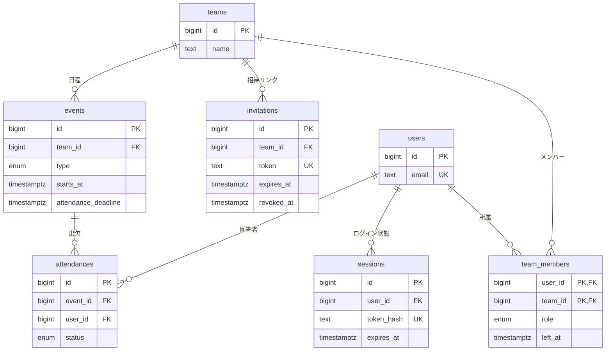

図 4　ER 図 (フェーズ 1)。主キー・外部キー・一意キーと主な列のみ示す

詳細な列は 7.3 節のテーブル定義を参照してください。users と teams の間には直接の関係がなく、`team_members` が両者を結ぶことで「複数チームに所属」「チームごとに役割が違う」を実現しています。

## 7.2 クラス図 (フェーズ 1)

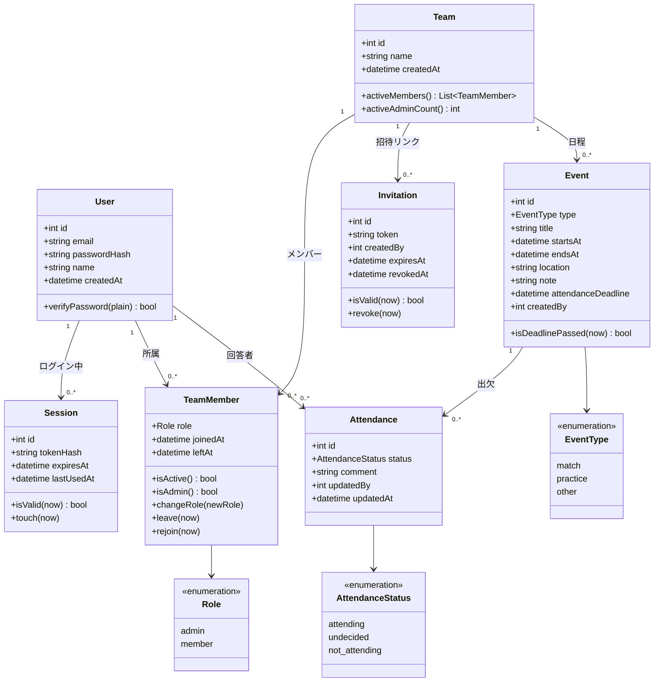

図 5　クラス図 (フェーズ 1)。SQLAlchemy のモデルに相当するドメインクラス

| **クラス** | **主なメソッド** | **意味** |
|---|---|---|
| User | verifyPassword | 入力されたパスワードが保存済みハッシュと一致するか。 |
| Session | isValid, touch | 有効期限内か。利用時に最終利用日時を更新 (1 時間に 1 回まで)。 |
| Team | activeMembers, activeAdminCount | 在籍メンバーの一覧と、在籍幹事の人数。最後の幹事の判定に使う。 |
| TeamMember | isActive, isAdmin, changeRole, leave, rejoin | 在籍判定 (leftAt が null)、役割変更、退会 (leftAt に現在時刻)、再参加 (leftAt を null、選手に戻す)。 |
| Invitation | isValid, revoke | 有効条件 (無効化されておらず期限内)、無効化 (revokedAt に現在時刻)。 |
| Event | isDeadlinePassed | 現在時刻が締切以降か。締切未設定は常に false。 |
| Attendance | (なし) | 日程 × ユーザーの出欠。1 件のみ (一意制約)。 |

> **読み方**
>
> 矢印の「1 → 0..\*」は「1 つの Team が 0 個以上の TeamMember を持つ」の意味です。createdBy / updatedBy は User への参照ですが、線が多くなるため属性として書いています。
>
> enumeration (Role など) は取りうる値の一覧です。

## 7.3 テーブル定義 (フェーズ 1)

### users

アカウント。フェーズ 1 ではアカウント削除・メール変更・パスワード変更は扱わない。

| **カラム** | **型** | **NULL** | **備考** |
|---|---|---|---|
| id | bigint PK | 不可 | |
| email | text | 不可 | UNIQUE。前後の空白を除き、小文字にして保存する。254 文字以内。 |
| password_hash | text | 不可 | argon2id のハッシュ。平文は保存しない。 |
| name | text | 不可 | 表示名。1〜50 文字。 |
| created_at | timestamptz | 不可 | 既定は now()。 |

### sessions [補完]

ログイン状態。Cookie にはトークンそのものを、DB にはその SHA-256 ハッシュだけを保存する。

| **カラム** | **型** | **NULL** | **備考** |
|---|---|---|---|
| id | bigint PK | 不可 | |
| user_id | bigint FK → users | 不可 | ON DELETE CASCADE。 |
| token_hash | text | 不可 | UNIQUE。トークンの SHA-256 (16 進 64 文字)。 |
| created_at | timestamptz | 不可 | ログイン日時。 |
| expires_at | timestamptz | 不可 | 有効期限。利用のたびに「現在 + 14 日」へ延長する (最終利用から 14 日)。 |
| last_used_at | timestamptz | 不可 | 最終利用日時。更新は前回から 1 時間以上たったときのみ (書き込みを減らす)。 |
| user_agent | text | 可 | ログイン時のブラウザ情報 (先頭 255 文字)。確認用。 |

インデックス: user_id、expires_at (期限切れの掃除用)。

### teams

チーム。フェーズ 1 ではチーム名の変更・チーム削除は扱わない。

| **カラム** | **型** | **NULL** | **備考** |
|---|---|---|---|
| id | bigint PK | 不可 | |
| name | text | 不可 | 1〜50 文字。 |
| created_at | timestamptz | 不可 | |

### team_members

ユーザーとチームの所属関係。権限はここの role で決まる。退会は行を消さず left_at に日時を入れる [D1]。

| **カラム** | **型** | **NULL** | **備考** |
|---|---|---|---|
| user_id | bigint FK → users | 不可 | 複合主キーの一部。ON DELETE RESTRICT。 |
| team_id | bigint FK → teams | 不可 | 複合主キーの一部。ON DELETE RESTRICT。 |
| role | text (enum) | 不可 | 'admin' または 'member'。 |
| joined_at | timestamptz | 不可 | 最新の参加日時。再参加のときは更新する。 |
| left_at | timestamptz | 可 | NULL = 在籍中。値あり = 退会済み (退会日時)。CHECK: left_at IS NULL OR left_at >= joined_at。 |

制約: 主キーは複合主キー (user_id, team_id) [D13]。1 人 1 行で、再参加も同じ行を使う (他テーブルから team_members を参照する外部キーはないため、代理キー id は持たない)。インデックス: (team_id, role) (チーム単位のメンバー検索と、在籍幹事の人数を数える用)。user_id での検索は主キーが先頭列で担う。

### invitations

招待リンク。状態の列は持たず、revoked_at と expires_at から計算する。

| **カラム** | **型** | **NULL** | **備考** |
|---|---|---|---|
| id | bigint PK | 不可 | |
| team_id | bigint FK → teams | 不可 | |
| token | text | 不可 | UNIQUE。推測不能な乱数 (secrets.token_urlsafe(32)、43 文字)。幹事が一覧で再表示するため平文で保存する。 |
| created_by | bigint FK → users | 不可 | 発行した幹事。 |
| created_at | timestamptz | 不可 | 発行日時 [補完]。 |
| expires_at | timestamptz | 不可 | 発行日時 + 7 日。 |
| revoked_at | timestamptz | 可 | 無効化した日時。NULL なら無効化されていない。 |

インデックス: (team_id, created_at)。

### events

日程。

| **カラム** | **型** | **NULL** | **備考** |
|---|---|---|---|
| id | bigint PK | 不可 | |
| team_id | bigint FK → teams | 不可 | |
| type | text (enum) | 不可 | 'match' / 'practice' / 'other'。 |
| title | text | 不可 | 1〜100 文字。 |
| starts_at | timestamptz | 不可 | |
| ends_at | timestamptz | 可 | CHECK: ends_at IS NULL OR ends_at > starts_at。 |
| location | text | 可 | 200 文字以内。 |
| note | text | 可 | 2000 文字以内。 |
| attendance_deadline | timestamptz | 可 | 未設定なら締切なし。CHECK: IS NULL OR <= starts_at。 |
| created_by | bigint FK → users | 不可 | |
| created_at | timestamptz | 不可 | [補完] |
| updated_at | timestamptz | 不可 | [補完] 更新のたびに更新する。 |

インデックス: (team_id, starts_at)。

### attendances

出欠。未回答は行を持たず、「在籍メンバー − 回答済み」で求める。

| **カラム** | **型** | **NULL** | **備考** |
|---|---|---|---|
| id | bigint PK | 不可 | |
| event_id | bigint FK → events | 不可 | ON DELETE CASCADE (日程を消すと出欠も消える)。 |
| user_id | bigint FK → users | 不可 | ON DELETE RESTRICT。フェーズ 3 で NULL 可になる (7.5 節)。 |
| status | text (enum) | 不可 | 'attending' (○) / 'undecided' (△) / 'not_attending' (×)。 |
| comment | text | 可 | 200 文字以内。 |
| updated_by | bigint FK → users | 不可 | 本人、または代理入力した幹事。 |
| updated_at | timestamptz | 不可 | |

制約: UNIQUE (event_id, user_id)。インデックス: (user_id)。回答者が「そのチームの在籍メンバーであること」は DB 制約ではなくアプリで検査する (退会後も行が残るため)。

## 7.4 フェーズ 2 のデータモデル

### 7.4.1 クラス図 (フェーズ 2)

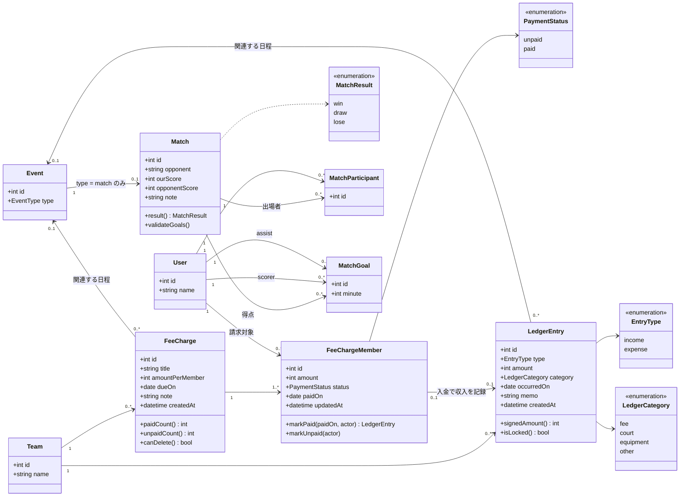

図 6　クラス図 (フェーズ 2: 会費・収支・試合結果)

| **クラス** | **主なメソッド** | **意味** |
|---|---|---|
| FeeCharge | paidCount, unpaidCount, canDelete | 請求。入金済みが 1 件でもあれば削除できない。 |
| FeeChargeMember | markPaid, markUnpaid | メンバーごとの支払い。入金済みにすると LedgerEntry (収入) を作り、未払いに戻すと削除する。 |
| LedgerEntry | signedAmount, isLocked | 収支 1 行。収入は +、支出は −で合計できる。会費入金から作られた行はロック (直接編集不可)。 |
| Match | result, validateGoals | 勝・分・負の判定、得点の記録数が自チーム得点以下か、などの整合チェック。 |
| MatchParticipant / MatchGoal | (なし) | 出場者、得点者とアシスト者。 |

### 7.4.2 ER 図 (会費・収支)

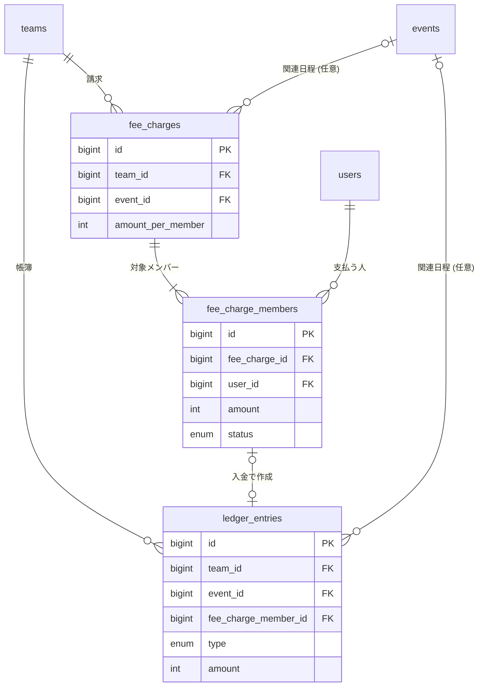

図 7　ER 図 (フェーズ 2: 会費・収支)

### 7.4.3 ER 図 (試合結果・成績)

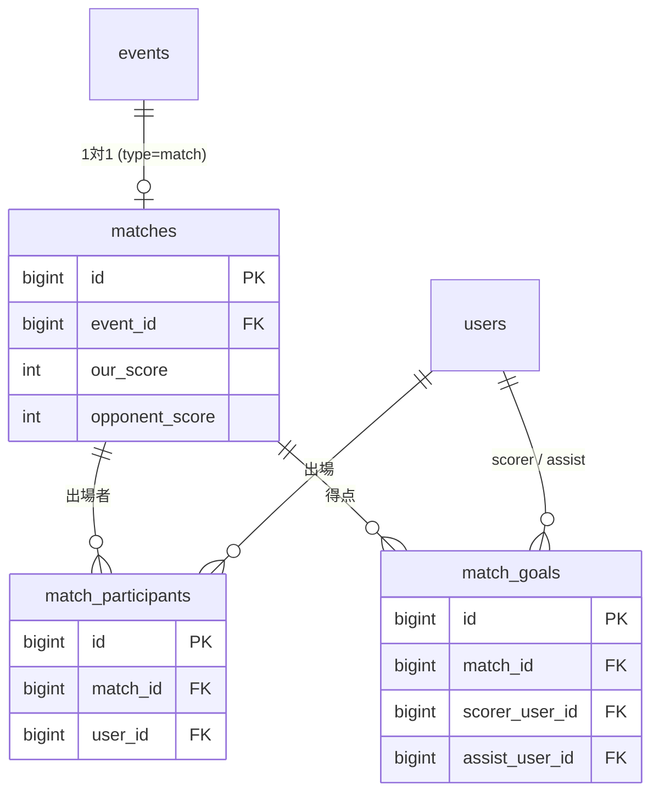

図 8　ER 図 (フェーズ 2: 試合結果・成績)

### 7.4.4 テーブル定義

### fee_charges

幹事が作る請求。例: 「11 月分会費 1,000 円」。

| **カラム** | **型** | **NULL** | **備考** |
|---|---|---|---|
| id | bigint PK | 不可 | |
| team_id | bigint FK → teams | 不可 | |
| title | text | 不可 | 1〜100 文字。 |
| amount_per_member | integer | 不可 | 1 人あたりの金額 (円)。CHECK: > 0。アプリで 1,000,000 以下に制限。 |
| due_on | date | 可 | 支払期限。 |
| event_id | bigint FK → events | 可 | 関連する日程。ON DELETE SET NULL。 |
| note | text | 可 | 500 文字以内。 |
| created_by | bigint FK → users | 不可 | |
| created_at / updated_at | timestamptz | 不可 | |

### fee_charge_members

請求ごと・メンバーごとの支払い状況。

| **カラム** | **型** | **NULL** | **備考** |
|---|---|---|---|
| id | bigint PK | 不可 | |
| fee_charge_id | bigint FK → fee_charges | 不可 | ON DELETE CASCADE。 |
| user_id | bigint FK → users | 不可 | |
| amount | integer | 不可 | 請求作成時の金額のコピー (後から請求側の金額が変わっても影響しない)。 |
| status | text (enum) | 不可 | 'unpaid' (既定) / 'paid'。 |
| paid_on | date | 可 | 入金日。CHECK: (status = 'paid') = (paid_on IS NOT NULL)。 |
| updated_by | bigint FK → users | 不可 | 操作した幹事。 |
| updated_at | timestamptz | 不可 | |

制約: UNIQUE (fee_charge_id, user_id)。インデックス: (user_id)。

### ledger_entries

収支の 1 行。決済ではなく記録。

| **カラム** | **型** | **NULL** | **備考** |
|---|---|---|---|
| id | bigint PK | 不可 | |
| team_id | bigint FK → teams | 不可 | |
| type | text (enum) | 不可 | 'income' (収入) / 'expense' (支出)。 |
| amount | integer | 不可 | 円。CHECK: > 0。符号は type で表す。 |
| category | text (enum) | 不可 | 'fee' (会費) / 'court' (コート代) / 'equipment' (備品) / 'other' (その他)。 |
| occurred_on | date | 不可 | 発生日。 |
| memo | text | 可 | 200 文字以内。 |
| event_id | bigint FK → events | 可 | 関連する日程。ON DELETE SET NULL。 |
| fee_charge_member_id | bigint FK → fee_charge_members | 可 | UNIQUE。会費の入金から自動作成した行だけ値を持つ。値があれば「ロック」(直接の修正・削除不可)。CHECK: 値ありなら type = 'income' AND category = 'fee'。 |
| created_by | bigint FK → users | 不可 | |
| created_at / updated_at | timestamptz | 不可 | |

インデックス: (team_id, occurred_on)。

### matches

試合結果。日程 (種別 = 試合) と 1 対 1。

| **カラム** | **型** | **NULL** | **備考** |
|---|---|---|---|
| id | bigint PK | 不可 | |
| event_id | bigint FK → events | 不可 | UNIQUE。ON DELETE RESTRICT (結果を先に削除しないと日程を削除できない)。 |
| opponent | text | 不可 | 対戦相手。1〜100 文字。 |
| our_score | integer | 不可 | 自チームの得点。CHECK: >= 0。 |
| opponent_score | integer | 不可 | 相手の得点。CHECK: >= 0。 |
| note | text | 可 | 1000 文字以内。 |
| created_by | bigint FK → users | 不可 | |
| created_at / updated_at | timestamptz | 不可 | |

アプリで検査: 紐づく日程の type が match であること。

### match_participants

実際に出場した人。出欠の「○」とは別に記録する (欠席予定でも急きょ参加などがあるため)。

| **カラム** | **型** | **NULL** | **備考** |
|---|---|---|---|
| id | bigint PK | 不可 | |
| match_id | bigint FK → matches | 不可 | ON DELETE CASCADE。 |
| user_id | bigint FK → users | 不可 | |

制約: UNIQUE (match_id, user_id)。インデックス: (user_id)。

### match_goals

得点者とアシスト者。1 得点 = 1 行。

| **カラム** | **型** | **NULL** | **備考** |
|---|---|---|---|
| id | bigint PK | 不可 | |
| match_id | bigint FK → matches | 不可 | ON DELETE CASCADE。 |
| scorer_user_id | bigint FK → users | 不可 | 得点者。出場者に含まれること (アプリで検査)。 |
| assist_user_id | bigint FK → users | 可 | アシスト者。CHECK: assist_user_id IS NULL OR assist_user_id <> scorer_user_id。 |
| minute | integer | 可 | 得点の時間 (分)。1〜150。 |

インデックス: (scorer_user_id)、(assist_user_id)、(match_id)。

## 7.5 フェーズ 3 のデータモデル

### 7.5.1 クラス図 (フェーズ 3)

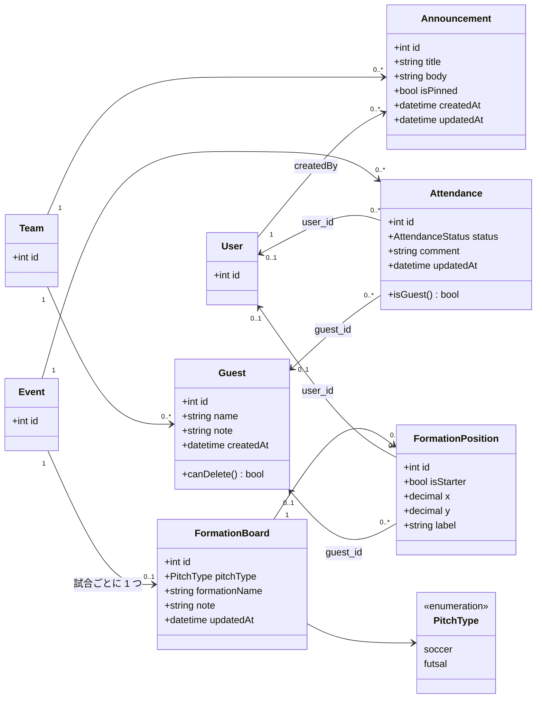

図 9　クラス図 (フェーズ 3: お知らせ・助っ人・フォーメーション)

### 7.5.2 ER 図 (フェーズ 3)

```mermaid
erDiagram
  teams ||--o{ announcements : "お知らせ"
  teams ||--o{ guests : "助っ人"
  events ||--o{ attendances : "出欠"
  users |o--o{ attendances : "user_id"
  guests |o--o{ attendances : "guest_id"
  events ||--o| formation_boards : "試合ごと"
  formation_boards ||--o{ formation_positions : "配置"
  users |o--o{ formation_positions : "user_id"
  guests |o--o{ formation_positions : "guest_id"

  announcements {
    bigint id PK
    bigint team_id FK
    boolean is_pinned
  }
  guests {
    bigint id PK
    bigint team_id FK
    text name
  }
  attendances {
    bigint id PK
    bigint event_id FK
    bigint user_id FK "選手のとき値あり"
    bigint guest_id FK "助っ人のとき値あり"
    enum status
  }
  formation_boards {
    bigint id PK
    bigint event_id FK
    enum pitch_type
  }
  formation_positions {
    bigint id PK
    bigint board_id FK
    bigint user_id FK
    bigint guest_id FK
    boolean is_starter
    numeric x
    numeric y
  }
```

図 10　ER 図 (フェーズ 3)

### 7.5.3 テーブル定義

### announcements

チーム単位のお知らせ。

| **カラム** | **型** | **NULL** | **備考** |
|---|---|---|---|
| id | bigint PK | 不可 | |
| team_id | bigint FK → teams | 不可 | |
| title | text | 不可 | 1〜100 文字。 |
| body | text | 不可 | 1〜5000 文字。プレーンテキスト。 |
| is_pinned | boolean | 不可 | 既定 false。true は一覧の先頭に表示。 |
| created_by | bigint FK → users | 不可 | |
| created_at / updated_at | timestamptz | 不可 | |

インデックス: (team_id, is_pinned, created_at)。

### guests

助っ人。アカウントを持たない参加者。チームに属し、複数の日程で使い回せる。

| **カラム** | **型** | **NULL** | **備考** |
|---|---|---|---|
| id | bigint PK | 不可 | |
| team_id | bigint FK → teams | 不可 | |
| name | text | 不可 | 1〜50 文字。 |
| note | text | 可 | 200 文字以内。 |
| created_by | bigint FK → users | 不可 | |
| created_at | timestamptz | 不可 | |

### attendances の変更 (フェーズ 3)

助っ人も出欠を持てるよう、user_id と guest_id のどちらか一方を持つ形にする。

| **カラム** | **型** | **NULL** | **備考** |
|---|---|---|---|
| user_id | bigint FK → users | 可 | NOT NULL を外す。選手のときだけ値を持つ。 |
| guest_id (追加) | bigint FK → guests | 可 | 助っ人のときだけ値を持つ。ON DELETE RESTRICT。 |

追加する制約:

- CHECK: (user_id IS NOT NULL)::int + (guest_id IS NOT NULL)::int = 1 (どちらか一方だけ)。
- UNIQUE (event_id, guest_id)。既存の UNIQUE (event_id, user_id) はそのまま。PostgreSQL では NULL 同士は重複と見なされないため両立できる。
- 既存の行はすべて user_id が入っているため、マイグレーションはそのまま通る。

### formation_boards

試合ごとの、スタメン・フォーメーションの保存先。

| **カラム** | **型** | **NULL** | **備考** |
|---|---|---|---|
| id | bigint PK | 不可 | |
| event_id | bigint FK → events | 不可 | UNIQUE (1 試合に 1 ボード)。ON DELETE CASCADE。アプリで type = match を検査。 |
| pitch_type | text (enum) | 不可 | 'soccer' / 'futsal'。 |
| formation_name | text | 可 | 例: 4-4-2。20 文字以内。 |
| note | text | 可 | 500 文字以内。 |
| updated_by | bigint FK → users | 不可 | |
| created_at / updated_at | timestamptz | 不可 | |

### formation_positions

ボード上の 1 人分の配置。

| **カラム** | **型** | **NULL** | **備考** |
|---|---|---|---|
| id | bigint PK | 不可 | |
| board_id | bigint FK → formation_boards | 不可 | ON DELETE CASCADE。 |
| user_id | bigint FK → users | 可 | 選手のとき。 |
| guest_id | bigint FK → guests | 可 | 助っ人のとき。 |
| is_starter | boolean | 不可 | true = スタメン、false = ベンチ。 |
| x | numeric(5,2) | 可 | 横位置 0〜100 (左端が 0)。スタメンは必須、ベンチは NULL。 |
| y | numeric(5,2) | 可 | 縦位置 0〜100 (上端が 0)。スタメンは必須、ベンチは NULL。 |
| label | text | 可 | 背番号やポジション名。10 文字以内。 |

制約: CHECK で user_id と guest_id のどちらか一方、is_starter なら x・y が 0〜100。UNIQUE (board_id, user_id)、UNIQUE (board_id, guest_id)。

## 7.6 外部キー・インデックス・整合性の方針

### 7.6.1 外部キーの削除時の動作

| **外部キー** | **ON DELETE** | **理由** |
|---|---|---|
| attendances.event_id、formation_boards.event_id | CASCADE | 日程を消したら一緒に消えてよい従属データ。 |
| fee_charge_members.fee_charge_id / match_participants.match_id / match_goals.match_id / formation_positions.board_id | CASCADE | 親を消したら子も不要。 |
| sessions.user_id | CASCADE | ユーザーが消えたらログイン状態も不要 (ユーザー削除は未実装)。 |
| matches.event_id | RESTRICT | 結果を持つ日程を、うっかり消さないため。結果を先に削除させる。 |
| fee_charges.event_id / ledger_entries.event_id | SET NULL | 日程を消しても請求・帳簿の記録は残す。 |
| ledger_entries.fee_charge_member_id | RESTRICT | 帳簿の記録が先に消えないようにする。 |
| その他 (team_id、user_id、created_by など) | 指定なし (既定の NO ACTION) | RESTRICT と同じく、参照されている行は消せない。チーム・ユーザーの削除は未実装で、履歴を守る。 |

### 7.6.2 インデックス

| **テーブル** | **インデックス** | **用途** |
|---|---|---|
| users | UNIQUE (email) | ログイン、重複登録の拒否 |
| sessions | UNIQUE (token_hash)、(user_id)、(expires_at) | リクエストごとの認証、期限切れの掃除 |
| team_members | 主キー (user_id, team_id)、(team_id, role) | 所属判定、所属チーム一覧、在籍幹事の人数 |
| invitations | UNIQUE (token)、(team_id, created_at) | リンクの検索、幹事の一覧 |
| events | (team_id, starts_at) | 日程一覧 (期間絞り込み・並び順) |
| attendances | UNIQUE (event_id, user_id)、(user_id) | 出欠の回答 (UPSERT)、自分の出欠の検索 |
| fee_charge_members | UNIQUE (fee_charge_id, user_id)、(user_id) | 請求詳細、自分の会費 |
| ledger_entries | (team_id, occurred_on)、UNIQUE (fee_charge_member_id) | 帳簿の期間絞り込み、入金との 1 対 1 |
| matches | UNIQUE (event_id) | 日程から結果を引く |
| match_participants / match_goals | (user_id) / (scorer_user_id)、(assist_user_id) | 成績の集計 |

### 7.6.3 DB 制約とアプリでの検査の分担

| **ルール** | **担当** | **メモ** |
|---|---|---|
| メールの重複、1 人 1 チーム 1 行 (複合主キー)、1 人 1 日程 1 出欠 (UNIQUE) | DB | 同時リクエストでも守られる。違反は 409 に変換する。 |
| 日時の前後関係、金額 > 0、列挙値 | DB (CHECK) と Pydantic | 入口で 422、最後の砦で DB。 |
| 最後の幹事は降格・退会できない | アプリ + 行ロック | SELECT ... FOR UPDATE で同時操作を直列化 (10.1 節)。 |
| 回答者・請求対象・出場者が「在籍メンバー」であること | アプリ | 退会後も行を残すため DB 制約にできない。 |
| 日程 type = match のときだけ結果・ボードを持てる | アプリ | 結果登録時に検査。結果がある日程は種別変更不可。 |
| 得点の記録数 ≤ 自チーム得点、得点者は出場者 | アプリ | PUT .../match で検査。 |

## 7.7 バックエンドのクラス構成

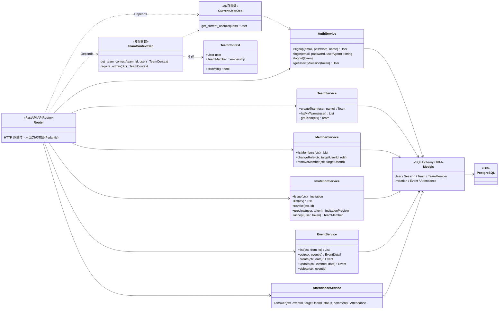

図 11　バックエンドのクラス構成 (層構造)

| **層** | **役割** | **してよいこと / いけないこと** |
|---|---|---|
| Router | HTTP の入口。Pydantic で入出力を検証し、Service を呼ぶ。 | 業務ルールは書かない。薄く保つ。 |
| 依存関数 (deps) | get_current_user (Cookie → セッション → ユーザー)、get_team_context (在籍メンバー確認、404)、require_admin (403)。 | 認証・認可の共通処理をここに集約する。 |
| TeamContext | 1 リクエストの「誰が・どのチームで・どの役割か」を運ぶ入れ物。 | Service に渡して使う。 |
| Service | 業務ルールとトランザクション (退会、招待、出欠など)。 | team_id を必ず条件に含めてデータを取得する (4.5 節)。 |
| Models | SQLAlchemy のモデル。 | 業務ルールを埋め込みすぎない (メソッドは判定程度)。 |

> **やさしい解説: 「1 リクエスト = 1 トランザクション」**
>
> トランザクションとは「全部成功するか、全部なかったことにするか」の単位です。たとえば退会処理では「left_at を更新」「将来の出欠を削除」を同時に行います。途中で失敗したときに片方だけ反映されると不整合になるため、1 回の API 呼び出しの中の変更は 1 つのトランザクションにまとめ、最後に 1 回だけ commit します。
>
> エラー (AppError) が発生したら rollback し、エラー JSON を返します。

# 8. API 仕様

## 8.1 共通仕様

| **項目** | **内容** |
|---|---|
| **形式** | JSON (Content-Type: application/json)。文字コードは UTF-8。 |
| **認証** | Cookie session_id (httpOnly)。フロントは credentials: "include" で送る。詳細は第 9 章。 |
| **日時** | ISO 8601、UTC (例: "2026-11-21T00:00:00Z")。日付のみの項目は "2026-11-21" (JST の日付)。表示時に JST へ変換する。 |
| **ID** | 整数 (JSON の number)。 |
| **一覧のページング** | クエリ limit (既定 50、最大 200)、offset (既定 0)。レスポンスは {"items": [...], "total": 123}。 |
| **URL の {team_id}** | {team_id} を含む API は、すべて 4.5 節の順序 (ログイン → 在籍メンバー → 役割) で検査する。以下の各 API の「権限」欄では、「メンバー」= 在籍メンバー、「幹事」= 在籍メンバーかつ role が admin。 |
| **書き込み系の保護** | POST / PUT / PATCH / DELETE は Origin ヘッダを検査する (9.6 節)。不一致は 403 CSRF_ORIGIN_MISMATCH。 |

### 8.1.1 エラーレスポンス

すべてのエラーは次の形式で返します。code はフロントの分岐用、message は画面表示用 (日本語) です。

```json
{
  "error": {
    "code": "LAST_ADMIN",
    "message": "最後の幹事は降格・退会できません",
    "details": null
  }
}
```

入力エラー (422) のときは details に項目ごとのエラー ([{"field": "title", "message": "..."}]) を入れます。FastAPI 標準の 422 は例外ハンドラで上記の形式に変換します。

| **HTTP** | **意味** | **主な使い方** |
|---|---|---|
| 200 / 201 / 204 | 成功 / 作成成功 / 成功 (本文なし) | 取得・更新は 200、作成は 201、削除は 204。 |
| 401 | 未ログイン | セッションがない、または期限切れ。 |
| 403 | 権限なし | メンバーだが幹事ではない、締切後の回答など。 |
| 404 | 見つからない | 存在しない、または見せない (他チーム・退会済み)。 |
| 409 | 競合・状態の矛盾 | メール重複、最後の幹事、すでに参加済みなど。 |
| 410 | 期限切れ | 招待リンクの期限切れ・無効化。 |
| 422 | 入力が不正 | 形式・範囲・整合性のエラー。 |
| 500 | サーバーエラー | 内部情報は返さず、汎用メッセージにする。 |

## 8.2 フェーズ 1: 認証・ユーザー

### POST /auth/signup　ユーザー登録

| | |
|---|---|
| **権限** | 公開 |
| **リクエスト** | { "name": "田中", "email": "tanaka@example.com", "password": "********" } |
| **成功時** | 201。登録と同時にログインする (Set-Cookie: session_id=...)。<br>本文: {"id": 1, "email": "tanaka@example.com", "name": "田中"} |
| **処理・規則** | - メールは前後の空白を除いて小文字にしてから重複を調べる。<br>- パスワードは argon2id でハッシュ化して保存する。<br>- name は前後の空白を除いてから 1〜50 文字、email 形式かつ 254 文字以内、password 8〜128 文字 (password は空白も含めて入力どおりに扱う)。 |
| **エラー** | 409 EMAIL_ALREADY_REGISTERED<br>422 VALIDATION_ERROR |

### POST /auth/login　ログイン

| | |
|---|---|
| **権限** | 公開 |
| **リクエスト** | { "email": "tanaka@example.com", "password": "********" } |
| **成功時** | 200。Set-Cookie: session_id=... と、本文 {"id": 1, "email": "...", "name": "田中"} |
| **処理・規則** | - 手順は 9.4 節。<br>- メールが存在しない場合も、ダミーのハッシュ検証を行って処理時間を揃える。<br>- 成功のたびに新しいセッションを作る (古いトークンを使い回さない)。 |
| **エラー** | 401 INVALID_CREDENTIALS (メッセージは「メールかパスワードが違います」のみ)<br>422 VALIDATION_ERROR |

### POST /auth/logout　ログアウト

| | |
|---|---|
| **権限** | ログイン |
| **成功時** | 204。DB の該当セッション行を削除し、Cookie を削除する (Max-Age=0)。 |
| **処理・規則** | 冪等にする。セッションが既になくても 204 を返す。 |
| **エラー** | (なし) |

### GET /me　ログイン中のユーザー情報

| | |
|---|---|
| **権限** | ログイン |
| **成功時** | 200 {"id": 1, "email": "tanaka@example.com", "name": "田中", "created_at": "..."} |
| **エラー** | 401 UNAUTHENTICATED |

## 8.3 フェーズ 1: チーム・メンバー

### GET /teams　自分の所属チーム一覧

| | |
|---|---|
| **権限** | ログイン |
| **成功時** | 200 {"items": [{"id": 5, "name": "FC サンプル", "role": "admin", "joined_at": "..."}]} |
| **処理・規則** | 在籍中 (left_at IS NULL) のチームだけを、チーム名順で返す。 |
| **エラー** | 401 UNAUTHENTICATED |

### POST /teams　チーム作成

| | |
|---|---|
| **権限** | ログイン |
| **リクエスト** | { "name": "FC サンプル" } |
| **成功時** | 201 {"id": 5, "name": "FC サンプル", "role": "admin", "created_at": "..."} |
| **処理・規則** | 1 つのトランザクションで、teams と、作成者の team_members (role = admin) を作る。 |
| **エラー** | 401 UNAUTHENTICATED<br>422 VALIDATION_ERROR (name は 1〜50 文字) |

### GET /teams/{team_id}　チーム情報と自分の役割

| | |
|---|---|
| **権限** | メンバー |
| **成功時** | 200 {"id": 5, "name": "FC サンプル", "role": "member", "member_count": 18, "created_at": "..."} |
| **エラー** | 401 UNAUTHENTICATED (未ログイン)<br>404 NOT_FOUND (チーム非所属・退会済み、または対象が存在しない) |

### GET /teams/{team_id}/members　メンバー一覧

| | |
|---|---|
| **権限** | メンバー (include_left は幹事のみ) |
| **パラメータ** | include_left (bool、既定 false): true で退会済みも含める。 |
| **成功時** | 200<br>{"items": [{"user_id": 1, "name": "田中", "email": "tanaka@example.com", "role": "admin", "joined_at": "...", "left_at": null}]} |
| **処理・規則** | - 既定は在籍中のみ。役割 (幹事が先)、参加日の順。<br>- **email は幹事にだけ返す** (選手には null)。<br>- 選手が include_left=true を指定したら 403。 |
| **エラー** | 401 UNAUTHENTICATED (未ログイン)<br>404 NOT_FOUND (チーム非所属・退会済み、または対象が存在しない)<br>403 FORBIDDEN (選手が include_left を指定) |

### PATCH /teams/{team_id}/members/{user_id}　役割変更

| | |
|---|---|
| **権限** | 幹事 |
| **リクエスト** | { "role": "member" } |
| **成功時** | 200 {"user_id": 2, "role": "member"} |
| **処理・規則** | - 対象は在籍メンバー。<br>- 幹事を選手に降格するとき、在籍幹事が 1 人だけなら拒否する (10.1 節)。<br>- 同じ役割への変更は何もせず 200。自分自身の降格も、他に幹事がいれば可。 |
| **エラー** | 401 UNAUTHENTICATED (未ログイン)<br>404 NOT_FOUND (チーム非所属・退会済み、または対象が存在しない)<br>403 FORBIDDEN (幹事ではない)<br>409 LAST_ADMIN<br>422 VALIDATION_ERROR |

### DELETE /teams/{team_id}/members/{user_id}　退会処理 (自分の脱退を含む)

| | |
|---|---|
| **権限** | 幹事 / 本人 |
| **成功時** | 204。left_at に現在時刻を入れる (論理的な退会)。 |
| **処理・規則** | - 幹事は誰でも退会させられる。選手は**自分自身だけ**。<br>- 最後の幹事は不可。<br>- 将来の日程 (開始前) の出欠は削除し、過去の履歴は残す。<br>- 手順と詳細は 10.1 節。 |
| **エラー** | 401 UNAUTHENTICATED (未ログイン)<br>404 NOT_FOUND (チーム非所属・退会済み、または対象が存在しない)<br>403 FORBIDDEN (選手が他人を退会させようとした)<br>409 LAST_ADMIN |

## 8.4 フェーズ 1: 招待

### POST /teams/{team_id}/invitations　招待リンク発行

| | |
|---|---|
| **権限** | 幹事 |
| **成功時** | 201 {"id": 3, "token": "Zk9x...", "invite_path": "/invite/Zk9x...", "created_at": "...", "expires_at": "2026-11-24T09:00:00Z"} |
| **処理・規則** | expires_at は発行日時 + 7 日。リクエスト本文はなし。フロントは invite_path から完全な URL を組み立てる。 |
| **エラー** | 401 UNAUTHENTICATED (未ログイン)<br>404 NOT_FOUND (チーム非所属・退会済み、または対象が存在しない)<br>403 FORBIDDEN (幹事ではない) |

### GET /teams/{team_id}/invitations　招待リンク一覧

| | |
|---|---|
| **権限** | 幹事 |
| **成功時** | 200 {"items": [{"id": 3, "token": "...", "created_by": {"user_id": 1, "name": "田中"}, "created_at": "...", "expires_at": "...", "revoked_at": null, "status": "active"}]} |
| **処理・規則** | 新しい順。status は active / expired / revoked を計算して返す (revoked を優先)。 |
| **エラー** | 401 UNAUTHENTICATED (未ログイン)<br>404 NOT_FOUND (チーム非所属・退会済み、または対象が存在しない)<br>403 FORBIDDEN (幹事ではない) |

### DELETE /teams/{team_id}/invitations/{id}　招待リンク無効化

| | |
|---|---|
| **権限** | 幹事 |
| **成功時** | 204。revoked_at に現在時刻を入れる。 |
| **処理・規則** | 冪等にする (すでに無効化済みでも 204)。物理削除はしない。すでに参加した人には影響しない。 |
| **エラー** | 401 UNAUTHENTICATED (未ログイン)<br>404 NOT_FOUND (チーム非所属・退会済み、または対象が存在しない。別チームの招待も 404)<br>403 FORBIDDEN (幹事ではない) |

### GET /invitations/{token}　招待先チーム名の確認

| | |
|---|---|
| **権限** | ログイン |
| **成功時** | 200 {"team_name": "FC サンプル", "already_member": false, "expires_at": "..."} |
| **処理・規則** | already_member は、そのチームの在籍メンバーかどうか。 |
| **エラー** | 401 UNAUTHENTICATED<br>404 NOT_FOUND (トークンが存在しない)<br>410 INVITATION_EXPIRED (期限切れ)<br>410 INVITATION_REVOKED (無効化済み) |

### POST /invitations/{token}/accept　招待を受けて参加

| | |
|---|---|
| **権限** | ログイン |
| **成功時** | 200 {"team_id": 5, "role": "member", "rejoined": false} |
| **処理・規則** | - 1 つのトランザクションで、トークンを再検証 → team_members を検索。<br>- 行なし → role = member で作成。退会済み (left_at あり) → left_at = NULL、role = member、joined_at = 現在 に更新し rejoined: true。在籍中 → 409。<br>- 詳細は 10.2 節。 |
| **エラー** | 401 UNAUTHENTICATED<br>404 NOT_FOUND<br>409 ALREADY_MEMBER<br>410 INVITATION_EXPIRED / INVITATION_REVOKED |

## 8.5 フェーズ 1: 日程・出欠

日程の JSON (EventOut) は、次の項目を持ちます。

```json
{
  "id": 9, "team_id": 5, "type": "match", "title": "リーグ第5節",
  "starts_at": "2026-11-21T00:00:00Z", "ends_at": "2026-11-21T02:00:00Z",
  "location": "○○グラウンド", "note": null,
  "attendance_deadline": "2026-11-19T14:59:00Z",
  "created_by": {"user_id": 1, "name": "田中"},
  "created_at": "...", "updated_at": "..."
}
```

### GET /teams/{team_id}/events　日程一覧 (期間で絞り込み)

| | |
|---|---|
| **権限** | メンバー |
| **パラメータ** | from / to (日時または日付。from 以上 to 未満)、order (asc 既定 / desc)、limit、offset。from を省略すると「今日の 0 時 (JST) 以降」。 |
| **成功時** | 200 {"items": [...], "total": 12}。各要素は EventOut に次を加えたもの:<br>"my_status": "attending" / "undecided" / "not_attending" / null、"is_deadline_passed": false、"counts": {"attending": 8, "undecided": 2, "not_attending": 1, "unanswered": 7} |
| **処理・規則** | counts と my_status は、日程ごとに繰り返しクエリを投げず (N+1 を避け)、GROUP BY で一括集計する。unanswered は「在籍メンバー数 − 回答済み (在籍メンバーの分)」。 |
| **エラー** | 401 UNAUTHENTICATED (未ログイン)<br>404 NOT_FOUND (チーム非所属・退会済み、または対象が存在しない)<br>422 VALIDATION_ERROR (日付の形式が不正) |

### POST /teams/{team_id}/events　日程作成

| | |
|---|---|
| **権限** | 幹事 |
| **リクエスト** | {"type": "match", "title": "リーグ第5節", "starts_at": "2026-11-21T00:00:00Z", "ends_at": "2026-11-21T02:00:00Z", "location": "○○グラウンド", "note": null, "attendance_deadline": "2026-11-19T14:59:00Z"} |
| **成功時** | 201 EventOut |
| **処理・規則** | 検証は 11.2 節。created_by は呼び出した幹事。 |
| **エラー** | 401 UNAUTHENTICATED (未ログイン)<br>404 NOT_FOUND (チーム非所属・退会済み、または対象が存在しない)<br>403 FORBIDDEN (幹事ではない)<br>422 VALIDATION_ERROR |

### GET /teams/{team_id}/events/{event_id}　日程詳細 (出欠の集計つき)

| | |
|---|---|
| **権限** | メンバー |
| **成功時** | 200 EventOut に次を加えたもの:<br>"my_attendance": {"status": "attending", "comment": null} または null、<br>"can_answer": true (自分が今回答できるか。締切前、または幹事)、<br>"summary": {"attending": 8, "undecided": 2, "not_attending": 1, "unanswered": 7}、<br>"attendances": [{"user_id": 2, "name": "佐藤", "status": "attending", "comment": "遅れます", "updated_by": {"user_id": 2, "name": "佐藤"}, "updated_at": "...", "is_former_member": false}]、<br>"unanswered": [{"user_id": 3, "name": "鈴木"}] |
| **エラー** | 401 UNAUTHENTICATED (未ログイン)<br>404 NOT_FOUND (チーム非所属・退会済み、または対象が存在しない) |

### PATCH /teams/{team_id}/events/{event_id}　日程更新

| | |
|---|---|
| **権限** | 幹事 |
| **リクエスト** | 変更したい項目だけを送る (部分更新)。項目は日程作成と同じ。 |
| **成功時** | 200 EventOut |
| **処理・規則** | updated_at を更新する。締切を変更した場合は即時反映される。送られた項目だけで検証し、変更後の値の組み合わせ (開始・終了・締切の前後関係) も再検証する。 |
| **エラー** | 401 UNAUTHENTICATED (未ログイン)<br>404 NOT_FOUND (チーム非所属・退会済み、または対象が存在しない)<br>403 FORBIDDEN (幹事ではない)<br>422 VALIDATION_ERROR |

### DELETE /teams/{team_id}/events/{event_id}　日程削除

| | |
|---|---|
| **権限** | 幹事 |
| **成功時** | 204。その日程の出欠も一緒に消える (CASCADE)。 |
| **エラー** | 401 UNAUTHENTICATED (未ログイン)<br>404 NOT_FOUND (チーム非所属・退会済み、または対象が存在しない)<br>403 FORBIDDEN (幹事ではない) |

### PUT /teams/{team_id}/events/{event_id}/attendances/{user_id}　出欠の回答・変更

| | |
|---|---|
| **権限** | 本人 (締切前) / 幹事 |
| **リクエスト** | { "status": "attending", "comment": "遅れます" } |
| **成功時** | 200 {"user_id": 2, "status": "attending", "comment": "遅れます", "updated_by": {"user_id": 2, "name": "佐藤"}, "updated_at": "..."} |
| **処理・規則** | - INSERT ... ON CONFLICT (event_id, user_id) DO UPDATE で、回答も変更も同じ PUT で扱う。<br>- **本人**: 締切が未設定、または現在時刻が締切より前のときだけ可。<br>- **幹事**: 本人・他人・締切後のいずれも可 (代理入力)。updated_by に幹事の ID が入る。<br>- 選手が他人の分を入力するのは不可。対象は在籍メンバーであること。<br>- 判定の流れは 10.3 節。 |
| **エラー** | 401 UNAUTHENTICATED (未ログイン)<br>404 NOT_FOUND (チーム非所属・退会済み、または対象が存在しない。対象が在籍メンバーではない場合も 404)<br>403 FORBIDDEN (選手が他人の分を入力)<br>403 DEADLINE_PASSED (締切後に本人が回答)<br>422 VALIDATION_ERROR |

## 8.6 フェーズ 2: 会費・収支

### POST /teams/{team_id}/fee-charges　請求の作成

| | |
|---|---|
| **権限** | 幹事 |
| **リクエスト** | {"title": "11月分会費", "amount_per_member": 1000, "due_on": "2026-11-30", "event_id": null, "note": null, "user_ids": [1, 2, 3]} |
| **成功時** | 201 {"id": 3, "title": "...", "amount_per_member": 1000, "members": [{"user_id": 1, "amount": 1000, "status": "unpaid"}, ...]} |
| **処理・規則** | - user_ids を省略すると在籍メンバー全員が対象。指定する場合は全員が在籍メンバーで、1 人以上。<br>- 1 つのトランザクションで、fee_charges と、対象人数分の fee_charge_members (amount は金額のコピー、status = unpaid) を作る。<br>- event_id を指定する場合は、同じチームの日程であること。 |
| **エラー** | 401 UNAUTHENTICATED (未ログイン)<br>404 NOT_FOUND (チーム非所属・退会済み、または対象が存在しない)<br>403 FORBIDDEN (幹事ではない)<br>422 VALIDATION_ERROR |

### GET /teams/{team_id}/fee-charges　請求一覧

| | |
|---|---|
| **権限** | 幹事 |
| **成功時** | 200 {"items": [{"id": 3, "title": "...", "amount_per_member": 1000, "due_on": "...", "event_id": null, "created_at": "...", "paid_count": 10, "unpaid_count": 8, "paid_total": 10000, "unpaid_total": 8000}], "total": 4} |
| **処理・規則** | 新しい順。集計は GROUP BY で一括取得する。 |
| **エラー** | 401 UNAUTHENTICATED (未ログイン)<br>404 NOT_FOUND (チーム非所属・退会済み、または対象が存在しない)<br>403 FORBIDDEN (幹事ではない) |

### GET /teams/{team_id}/fee-charges/{charge_id}　請求詳細

| | |
|---|---|
| **権限** | 幹事 |
| **成功時** | 200 請求の項目 + "members": [{"user_id": 2, "name": "佐藤", "is_former_member": false, "amount": 1000, "status": "paid", "paid_on": "2026-11-20"}] |
| **エラー** | 401 UNAUTHENTICATED (未ログイン)<br>404 NOT_FOUND (チーム非所属・退会済み、または対象が存在しない)<br>403 FORBIDDEN (幹事ではない) |

### PATCH /teams/{team_id}/fee-charges/{charge_id}　請求の編集

| | |
|---|---|
| **権限** | 幹事 |
| **リクエスト** | title、due_on、note のみ (部分更新)。金額と対象メンバーは作成後に変更できない。 |
| **成功時** | 200 請求 |
| **エラー** | 401 UNAUTHENTICATED (未ログイン)<br>404 NOT_FOUND (チーム非所属・退会済み、または対象が存在しない)<br>403 FORBIDDEN (幹事ではない)<br>422 VALIDATION_ERROR |

### DELETE /teams/{team_id}/fee-charges/{charge_id}　請求の削除

| | |
|---|---|
| **権限** | 幹事 |
| **成功時** | 204。対象メンバーの行も一緒に消える。 |
| **処理・規則** | 入金済みが 1 件でもあれば削除できない (先に「未払いに戻す」)。 |
| **エラー** | 401 UNAUTHENTICATED (未ログイン)<br>404 NOT_FOUND (チーム非所属・退会済み、または対象が存在しない)<br>403 FORBIDDEN (幹事ではない)<br>409 CHARGE_HAS_PAYMENTS |

### PATCH /teams/{team_id}/fee-charges/{charge_id}/members/{user_id}　入金状況の変更

| | |
|---|---|
| **権限** | 幹事 |
| **リクエスト** | { "status": "paid", "paid_on": "2026-11-20" } (未払いに戻すときは {"status": "unpaid"}) |
| **成功時** | 200 {"user_id": 2, "amount": 1000, "status": "paid", "paid_on": "2026-11-20", "ledger_entry_id": 41} |
| **処理・規則** | - paid: 1 つのトランザクションで、行を FOR UPDATE でロックし、ledger_entries に収入 (カテゴリ = 会費、金額 = その人の amount、発生日 = paid_on) を作り、status と paid_on を更新する。<br>- paid_on は省略すると今日 (JST)。未来の日付は不可。<br>- unpaid: 紐づく ledger_entries の行を削除し、status = unpaid、paid_on = NULL に戻す。<br>- すでに同じ状態にしようとしたら 409。<br>- 10.4 節を参照。 |
| **エラー** | 401 UNAUTHENTICATED (未ログイン)<br>404 NOT_FOUND (チーム非所属・退会済み、または対象が存在しない)<br>403 FORBIDDEN (幹事ではない)<br>409 ALREADY_PAID / ALREADY_UNPAID<br>422 VALIDATION_ERROR |

### GET /teams/{team_id}/me/fees　自分の会費の支払い状況

| | |
|---|---|
| **権限** | メンバー |
| **成功時** | 200 {"unpaid_total": 2000, "items": [{"charge_id": 3, "title": "11月分会費", "amount": 1000, "status": "unpaid", "paid_on": null, "due_on": "2026-11-30"}]} |
| **処理・規則** | 呼び出した本人の分だけを返す (他人の分は見えない)。未払いを先に、期限の早い順。 |
| **エラー** | 401 UNAUTHENTICATED (未ログイン)<br>404 NOT_FOUND (チーム非所属・退会済み、または対象が存在しない) |

### GET /teams/{team_id}/ledger-entries　帳簿の一覧

| | |
|---|---|
| **権限** | 幹事 |
| **パラメータ** | from / to (日付、発生日で絞り込み)、type (income / expense)、category、limit、offset。 |
| **成功時** | 200 {"items": [{"id": 41, "type": "income", "amount": 1000, "category": "fee", "occurred_on": "2026-11-20", "memo": null, "event_id": null, "locked": true, "created_by": {...}}], "total": 30, "totals": {"income": 18000, "expense": 12000, "balance": 6000}} |
| **処理・規則** | 発生日の新しい順。totals は絞り込み後の全件の合計 (ページ内ではない)。locked は fee_charge_member_id が入っているか。 |
| **エラー** | 401 UNAUTHENTICATED (未ログイン)<br>404 NOT_FOUND (チーム非所属・退会済み、または対象が存在しない)<br>403 FORBIDDEN (幹事ではない) |

### POST /teams/{team_id}/ledger-entries　帳簿への追加

| | |
|---|---|
| **権限** | 幹事 |
| **リクエスト** | { "type": "expense", "amount": 5500, "category": "court", "occurred_on": "2026-11-21", "memo": "コート代", "event_id": 9 } |
| **成功時** | 201 帳簿の 1 行 |
| **処理・規則** | amount は 1 以上の整数。event_id は同じチームの日程であること。 |
| **エラー** | 401 UNAUTHENTICATED (未ログイン)<br>404 NOT_FOUND (チーム非所属・退会済み、または対象が存在しない)<br>403 FORBIDDEN (幹事ではない)<br>422 VALIDATION_ERROR |

### PATCH /teams/{team_id}/ledger-entries/{entry_id}　帳簿の修正

| | |
|---|---|
| **権限** | 幹事 |
| **リクエスト** | 変更したい項目だけを送る (type、amount、category、occurred_on、memo、event_id)。 |
| **成功時** | 200 帳簿の 1 行 |
| **エラー** | 401 UNAUTHENTICATED (未ログイン)<br>404 NOT_FOUND (チーム非所属・退会済み、または対象が存在しない)<br>403 FORBIDDEN (幹事ではない)<br>409 LEDGER_ENTRY_LOCKED (会費入金から自動作成された行)<br>422 VALIDATION_ERROR |

### DELETE /teams/{team_id}/ledger-entries/{entry_id}　帳簿の削除

| | |
|---|---|
| **権限** | 幹事 |
| **成功時** | 204 |
| **エラー** | 401 UNAUTHENTICATED (未ログイン)<br>404 NOT_FOUND (チーム非所属・退会済み、または対象が存在しない)<br>403 FORBIDDEN (幹事ではない)<br>409 LEDGER_ENTRY_LOCKED |

### GET /teams/{team_id}/ledger-summary　収支の集計

| | |
|---|---|
| **権限** | 幹事 |
| **パラメータ** | month (2026-11) または year (2026)。どちらも省略すると全期間。 |
| **成功時** | 200 {"from": "2026-11-01", "to": "2026-11-30", "income": 18000, "expense": 12000, "net": 6000, "balance": 54000, "by_category": [{"category": "fee", "type": "income", "total": 18000}]} |
| **処理・規則** | income / expense / net は指定期間の合計、balance はチームの現在までの累計残高。 |
| **エラー** | 401 UNAUTHENTICATED (未ログイン)<br>404 NOT_FOUND (チーム非所属・退会済み、または対象が存在しない)<br>403 FORBIDDEN (幹事ではない)<br>422 VALIDATION_ERROR |

## 8.7 フェーズ 2: 試合結果・成績

### GET /teams/{team_id}/events/{event_id}/match　試合結果の取得

| | |
|---|---|
| **権限** | メンバー |
| **成功時** | 200<br>{"opponent": "FC ライバル", "our_score": 3, "opponent_score": 1, "result": "win", "note": null,<br>"participants": [{"user_id": 1, "name": "田中"}],<br>"goals": [{"scorer": {"user_id": 1, "name": "田中"}, "assist": {"user_id": 2, "name": "佐藤"}, "minute": 23}]} |
| **エラー** | 401 UNAUTHENTICATED (未ログイン)<br>404 NOT_FOUND (チーム非所属・退会済み、または対象が存在しない。結果が未登録のときも 404) |

### PUT /teams/{team_id}/events/{event_id}/match　試合結果の登録・更新 (まとめて置き換え)

| | |
|---|---|
| **権限** | 幹事 |
| **リクエスト** | {"opponent": "FC ライバル", "our_score": 3, "opponent_score": 1, "note": null, "participant_user_ids": [1, 2, 3, 4, 5], "goals": [{"scorer_user_id": 1, "assist_user_id": 2, "minute": 23}, {"scorer_user_id": 1, "assist_user_id": null, "minute": 58}]} |
| **成功時** | 200 (取得と同じ形)。新規登録のときも 200。 |
| **処理・規則** | - 日程の種別が match であること。<br>- 1 つのトランザクションで、matches を作成または更新し、match_participants と match_goals を全件入れ替える。<br>- 出場者は在籍メンバーで、重複なし。<br>- 得点者・アシスト者は出場者に含まれること。得点者 ≠ アシスト者。<br>- **得点の記録数 ≤ our_score**。<br>- スコアが 0 以上の整数。 |
| **エラー** | 401 UNAUTHENTICATED (未ログイン)<br>404 NOT_FOUND (チーム非所属・退会済み、または対象が存在しない)<br>403 FORBIDDEN (幹事ではない)<br>422 EVENT_NOT_MATCH (種別が試合ではない)<br>422 VALIDATION_ERROR (整合性のエラーを含む) |

### DELETE /teams/{team_id}/events/{event_id}/match　試合結果の削除

| | |
|---|---|
| **権限** | 幹事 |
| **成功時** | 204。出場者・得点も一緒に消える。 |
| **エラー** | 401 UNAUTHENTICATED (未ログイン)<br>404 NOT_FOUND (チーム非所属・退会済み、または対象が存在しない)<br>403 FORBIDDEN (幹事ではない) |

### GET /teams/{team_id}/stats/team　チーム戦績

| | |
|---|---|
| **権限** | メンバー |
| **パラメータ** | year (省略すると全期間。JST の暦年で、日程の開始日時が基準)。 |
| **成功時** | 200 {"played": 20, "wins": 12, "draws": 3, "losses": 5, "goals_for": 41, "goals_against": 25} |
| **エラー** | 401 UNAUTHENTICATED (未ログイン)<br>404 NOT_FOUND (チーム非所属・退会済み、または対象が存在しない)<br>422 VALIDATION_ERROR |

### GET /teams/{team_id}/stats/players　選手別成績 (得点ランキング・出場回数)

| | |
|---|---|
| **権限** | メンバー |
| **パラメータ** | year (省略すると全期間)。 |
| **成功時** | 200 {"items": [{"user_id": 1, "name": "田中", "is_former_member": false, "appearances": 18, "goals": 12, "assists": 4, "goal_rank": 1}]} |
| **処理・規則** | 得点の多い順 → 出場回数の多い順。同数は同順位 (RANK())。集計の定義と SQL は 10.5 節。 |
| **エラー** | 401 UNAUTHENTICATED (未ログイン)<br>404 NOT_FOUND (チーム非所属・退会済み、または対象が存在しない)<br>422 VALIDATION_ERROR |

## 8.8 フェーズ 3: お知らせ

### GET /teams/{team_id}/announcements　お知らせ一覧

| | |
|---|---|
| **権限** | メンバー |
| **パラメータ** | limit、offset。 |
| **成功時** | 200 {"items": [{"id": 7, "title": "...", "preview": "本文の先頭 50 文字", "is_pinned": true, "created_by": {...}, "created_at": "...", "updated_at": "..."}], "total": 9} |
| **処理・規則** | ピン留めを先頭に、その中は新しい順。 |
| **エラー** | 401 UNAUTHENTICATED (未ログイン)<br>404 NOT_FOUND (チーム非所属・退会済み、または対象が存在しない) |

### POST /teams/{team_id}/announcements　お知らせの投稿

| | |
|---|---|
| **権限** | 幹事 |
| **リクエスト** | { "title": "11/21 は雨天決行です", "body": "...", "is_pinned": false } |
| **成功時** | 201 お知らせ (本文を含む) |
| **エラー** | 401 UNAUTHENTICATED (未ログイン)<br>404 NOT_FOUND (チーム非所属・退会済み、または対象が存在しない)<br>403 FORBIDDEN (幹事ではない)<br>422 VALIDATION_ERROR |

### GET /teams/{team_id}/announcements/{announcement_id}　お知らせ詳細

| | |
|---|---|
| **権限** | メンバー |
| **成功時** | 200 {"id": 7, "title": "...", "body": "...", "is_pinned": false, "created_by": {...}, "created_at": "...", "updated_at": "..."} |
| **エラー** | 401 UNAUTHENTICATED (未ログイン)<br>404 NOT_FOUND (チーム非所属・退会済み、または対象が存在しない) |

### PATCH /teams/{team_id}/announcements/{announcement_id}　お知らせの編集 (ピン留めの切替を含む)

| | |
|---|---|
| **権限** | 幹事 |
| **リクエスト** | title、body、is_pinned のうち変更したいものだけ。 |
| **成功時** | 200 お知らせ |
| **エラー** | 401 UNAUTHENTICATED (未ログイン)<br>404 NOT_FOUND (チーム非所属・退会済み、または対象が存在しない)<br>403 FORBIDDEN (幹事ではない)<br>422 VALIDATION_ERROR |

### DELETE /teams/{team_id}/announcements/{announcement_id}　お知らせの削除

| | |
|---|---|
| **権限** | 幹事 |
| **成功時** | 204 |
| **エラー** | 401 UNAUTHENTICATED (未ログイン)<br>404 NOT_FOUND (チーム非所属・退会済み、または対象が存在しない)<br>403 FORBIDDEN (幹事ではない) |

## 8.9 フェーズ 3: 助っ人

### GET /teams/{team_id}/guests　助っ人一覧

| | |
|---|---|
| **権限** | 幹事 |
| **成功時** | 200 {"items": [{"id": 2, "name": "山田", "note": "元同僚", "created_at": "...", "in_use": true}]} |
| **処理・規則** | in_use は、出欠またはフォーメーションで使われているか (削除可否の目安)。 |
| **エラー** | 401 UNAUTHENTICATED (未ログイン)<br>404 NOT_FOUND (チーム非所属・退会済み、または対象が存在しない)<br>403 FORBIDDEN (幹事ではない) |

### POST /teams/{team_id}/guests　助っ人の登録

| | |
|---|---|
| **権限** | 幹事 |
| **リクエスト** | { "name": "山田", "note": "元同僚" } |
| **成功時** | 201 助っ人 |
| **エラー** | 401 UNAUTHENTICATED (未ログイン)<br>404 NOT_FOUND (チーム非所属・退会済み、または対象が存在しない)<br>403 FORBIDDEN (幹事ではない)<br>422 VALIDATION_ERROR |

### PATCH /teams/{team_id}/guests/{guest_id}　助っ人の編集

| | |
|---|---|
| **権限** | 幹事 |
| **リクエスト** | name、note のうち変更したいものだけ。 |
| **成功時** | 200 助っ人 |
| **エラー** | 401 UNAUTHENTICATED (未ログイン)<br>404 NOT_FOUND (チーム非所属・退会済み、または対象が存在しない)<br>403 FORBIDDEN (幹事ではない)<br>422 VALIDATION_ERROR |

### DELETE /teams/{team_id}/guests/{guest_id}　助っ人の削除

| | |
|---|---|
| **権限** | 幹事 |
| **成功時** | 204 |
| **処理・規則** | 出欠またはフォーメーションで使われていれば削除できない。 |
| **エラー** | 401 UNAUTHENTICATED (未ログイン)<br>404 NOT_FOUND (チーム非所属・退会済み、または対象が存在しない)<br>403 FORBIDDEN (幹事ではない)<br>409 GUEST_IN_USE |

### PUT /teams/{team_id}/events/{event_id}/guest-attendances/{guest_id}　助っ人の出欠入力

| | |
|---|---|
| **権限** | 幹事 |
| **リクエスト** | { "status": "attending", "comment": null } |
| **成功時** | 200 {"guest_id": 2, "name": "山田", "status": "attending", "comment": null, "updated_at": "..."} |
| **処理・規則** | attendances に guest_id つきの行を UPSERT する。締切の制限はかからない (幹事の操作のため)。助っ人は同じチームのものであること。 |
| **エラー** | 401 UNAUTHENTICATED (未ログイン)<br>404 NOT_FOUND (チーム非所属・退会済み、または対象が存在しない)<br>403 FORBIDDEN (幹事ではない)<br>422 VALIDATION_ERROR |

### DELETE /teams/{team_id}/events/{event_id}/guest-attendances/{guest_id}　助っ人を日程から外す

| | |
|---|---|
| **権限** | 幹事 |
| **成功時** | 204。その日程の助っ人の出欠行を削除する。 |
| **エラー** | 401 UNAUTHENTICATED (未ログイン)<br>404 NOT_FOUND (チーム非所属・退会済み、または対象が存在しない)<br>403 FORBIDDEN (幹事ではない) |

日程詳細 (`GET .../events/{event_id}`) の拡張: フェーズ 3 で次を加えます。後方互換のため、既存の項目はそのままです。

```json
"guest_attendances": [{"guest_id": 2, "name": "山田", "status": "attending", "comment": null}],
"summary": {
  "attending": 8, "undecided": 2, "not_attending": 1, "unanswered": 7,   // 選手のみ (従来どおり)
  "guests": {"attending": 1, "undecided": 0, "not_attending": 0},        // 追加
  "attending_total": 9                                    // 追加: ○ の選手 + ○ の助っ人
}
```

## 8.10 フェーズ 3: フォーメーションボード

### GET /teams/{team_id}/events/{event_id}/board　ボードの取得

| | |
|---|---|
| **権限** | メンバー |
| **成功時** | 200<br>{"pitch_type": "soccer", "formation_name": "4-4-2", "note": null, "updated_at": "...",<br>"positions": [{"user_id": 1, "guest_id": null, "name": "田中", "is_starter": true, "x": 50.0, "y": 90.0, "label": "GK"}]} |
| **エラー** | 401 UNAUTHENTICATED (未ログイン)<br>404 NOT_FOUND (チーム非所属・退会済み、または対象が存在しない。ボードが未作成のときも 404) |

### PUT /teams/{team_id}/events/{event_id}/board　ボードの保存 (まとめて置き換え)

| | |
|---|---|
| **権限** | 幹事 |
| **リクエスト** | {"pitch_type": "soccer", "formation_name": "4-4-2", "note": null, "positions": [{"user_id": 1, "guest_id": null, "is_starter": true, "x": 50, "y": 90, "label": "GK"}, {"user_id": null, "guest_id": 2, "is_starter": false, "x": null, "y": null, "label": null}]} |
| **成功時** | 200 (取得と同じ形)。新規作成のときも 200。 |
| **処理・規則** | - 日程の種別が match であること。<br>- 各行は user_id と guest_id のどちらか一方だけ。選手は在籍メンバー、助っ人は同じチームのもの。同じ人を 2 回置かない。<br>- スタメンは x・y が 0〜100 で必須。ベンチは null。<br>- スタメン人数の上限: soccer 11 人、futsal 5 人。<br>- 1 つのトランザクションで、formation_boards を作成または更新し、formation_positions を全件入れ替える。 |
| **エラー** | 401 UNAUTHENTICATED (未ログイン)<br>404 NOT_FOUND (チーム非所属・退会済み、または対象が存在しない)<br>403 FORBIDDEN (幹事ではない)<br>422 EVENT_NOT_MATCH<br>422 VALIDATION_ERROR |

### DELETE /teams/{team_id}/events/{event_id}/board　ボードの削除

| | |
|---|---|
| **権限** | 幹事 |
| **成功時** | 204 |
| **エラー** | 401 UNAUTHENTICATED (未ログイン)<br>404 NOT_FOUND (チーム非所属・退会済み、または対象が存在しない)<br>403 FORBIDDEN (幹事ではない) |

## 8.11 既存 API への変更 (フェーズ 2・3)

| **API** | **変更** | **フェーズ** |
|---|---|---|
| PATCH .../events/{id} | 結果 (matches) がある日程の種別を match 以外に変更しようとしたら 409 EVENT_HAS_RESULT。 | 2 |
| DELETE .../events/{id} | 結果がある日程は 409 EVENT_HAS_RESULT (先に結果を削除)。 | 2 |
| GET .../events/{id} | 種別が match で結果があれば "match": {"opponent", "our_score", "opponent_score", "result"} を含める。 | 2 |
| GET .../events | 各要素に "match_result": "win" / "draw" / "lose" / null を追加。 | 2 |
| DELETE .../members/{uid} | 未払いの会費請求は残す。退会者への新規請求は不可。 | 2 |
| GET .../events/{id} | guest_attendances、summary.guests、summary.attending_total を追加 (8.9 節)。 | 3 |
| GET /teams/{id} | 変更なし。ホームのお知らせは GET .../announcements?limit=3 で取得。 | 3 |

# 9. 認証・セッション・セキュリティ

## 9.1 全体像

認証はメールアドレスとパスワードのみです。ログイン後の状態は サーバー側セッション で保持し、ブラウザには httpOnly Cookie でトークンだけを渡します [D2]。

> **やさしい解説: サーバー側セッションとは**
>
> ログインしたら、サーバーが「整理番号」を発行する仕組みです。
>
> 1. ログインに成功すると、サーバーは推測できない長いランダム文字列 (トークン) を作ります。
> 2. サーバーは DB の sessions に「このトークンは 1 番のユーザーのもの。◯月◯日まで有効」と記録します。
> 3. ブラウザには、記録の中身ではなく**トークンだけ**を Cookie として渡します。
> 4. ブラウザは以後、リクエストのたびに Cookie を自動で送ります。サーバーはトークンで DB を引き、「誰のログインか」を知ります。
>
> たとえるなら、ライブハウスの整理番号つきリストバンドです。リストバンドには番号しか書かれておらず、「誰の入場か」は受付の名簿 (DB) だけが知っています。名簿から消せば (ログアウト・強制失効)、そのリストバンドはその場で使えなくなります。
>
> ブラウザの JavaScript からは Cookie を読めない (httpOnly) ため、仮に画面にスクリプトを仕込まれても、トークンを盗まれにくくなります。

| | **サーバー側セッション (採用)** | **JWT (不採用)** |
|---|---|---|
| **状態の置き場** | サーバー (DB)。ブラウザは番号だけ持つ。 | トークン自身に情報が入っていて、サーバーは覚えない。 |
| **ログアウト** | DB の行を消せば即座に無効になる。 | トークンの期限まで有効なまま残る。即時失効には別の仕組み (失効リスト) が要る。 |
| **強制ログアウト** | 行を消すだけ。 | 難しい。 |
| **リクエストごとの負荷** | DB を 1 回引く (インデックスあり)。 | 不要 (署名の検証のみ)。 |
| **学べること** | セッション管理、期限切れ、失効の考え方。 | 署名、リフレッシュトークンの設計。 |

## 9.2 Cookie の仕様

| **属性** | **値** | **理由** |
|---|---|---|
| 名前 | session_id | |
| 値 | ランダムなトークン (secrets.token_urlsafe(32)、43 文字) | 推測できない長さ (約 256 ビット)。 |
| HttpOnly | 付ける | JavaScript から読めないようにする (XSS 対策)。 |
| Secure | 本番 (HTTPS) は付ける。開発 (http) は付けない (COOKIE_SECURE) | 暗号化されない通信で送らない。 |
| SameSite | Lax | 他サイトからの POST などで Cookie が送られるのを防ぐ (CSRF 対策の 1 つ)。 |
| Path | / | |
| Max-Age | 14 日 (1,209,600 秒) | 利用のたびに延長する (スライディング)。 |
| Domain | 指定しない | 発行したホストだけに送る。 |

## 9.3 セッションのライフサイクル

| **タイミング** | **sessions への処理** | **Cookie** |
|---|---|---|
| ログイン / 登録成功 | 新しいトークンを作り、ハッシュ (SHA-256) を保存。expires_at = 現在 + 14 日。同時に、そのユーザーの期限切れ行を削除する。 | Set-Cookie でトークンを設定。 |
| 認証が必要な API | 送られたトークンのハッシュで検索。expires_at が未来ならログイン中と判定。前回の last_used_at から 1 時間以上たっていたら、last_used_at と expires_at (現在 + 14 日) を更新。 | 更新したときは Set-Cookie で Max-Age も更新。 |
| ログアウト | 該当行を削除。 | Max-Age = 0 で削除。 |
| 期限切れ | 期限を過ぎた行は無効扱い (401)。行はログイン時に掃除する。将来は定期ジョブでも掃除できる。 | (ブラウザ側でも期限が来れば消える) |

- **トークンは DB にそのまま保存しない**。保存するのは SHA-256 ハッシュだけです。DB の中身が漏れても、そこからログインに使えるトークンは作れません。
- 1 ユーザーが複数のブラウザ・端末で同時にログインできます (行が複数)。
- ログインのたびに新しいトークンを発行します (セッション固定攻撃の対策)。
- パスワード変更・全端末ログアウトはフェーズ 1 では実装しません。将来、そのユーザーの sessions を全削除すれば実現できます。

## 9.4 ログイン処理の手順

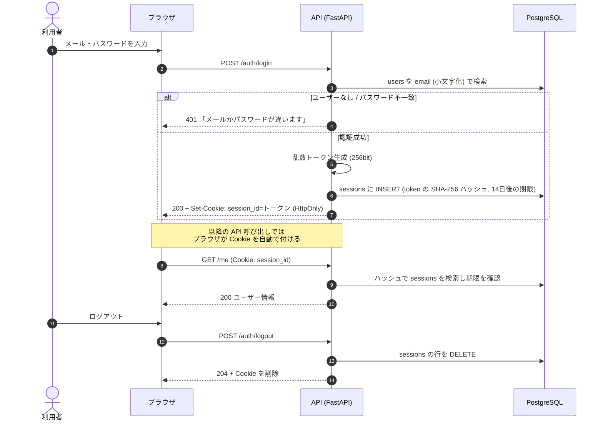

図 12　ログイン・セッション・ログアウトの流れ

1. 入力を検証する (メール形式、パスワード長)。
2. メールを小文字にして users を検索する。
3. 見つからない場合も、**ダミーのハッシュに対して検証を行い**、処理時間の差から「登録されているメールか」を推測されないようにする。
4. パスワードを argon2id で検証する。失敗なら 401 (「メールかパスワードが違います」)。
5. トークンを生成し、ハッシュを sessions に保存する。
6. Set-Cookie を付けて、ユーザー情報を返す。

## 9.5 リクエストごとの認証・認可

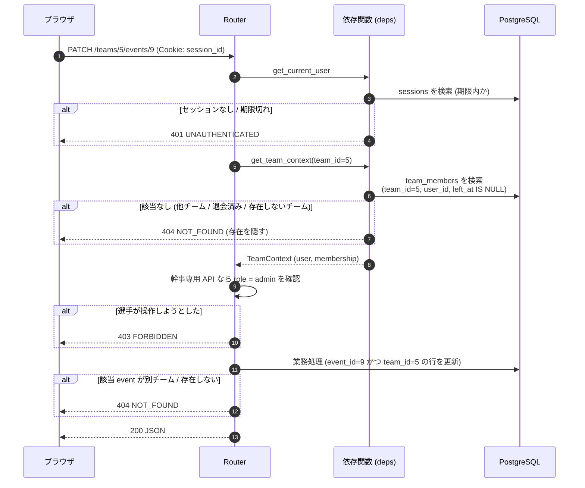

図 13　認証・認可の流れ (リクエストごと)

Router に付ける依存関数が、4.5 節の順序で検査します。Service は TeamContext を受け取るだけで、認証・認可の細部を知らなくて済みます。

```python
# 擬似コード (deps.py)
def get_current_user(request, db) -> User:
    token = request.cookies.get("session_id")
    session = find_valid_session(db, sha256(token))  # 期限内のみ
    if session is None:
        raise AppError(401, "UNAUTHENTICATED", "ログインが必要です")
    return session.user

def get_team_context(team_id, user=Depends(get_current_user), db=...) -> TeamContext:
    m = active_membership(db, team_id, user.id)  # left_at IS NULL
    if m is None:
        raise AppError(404, "NOT_FOUND", "見つかりません")  # 403 ではなく 404
    return TeamContext(user, m)

def require_admin(ctx=Depends(get_team_context)) -> TeamContext:
    if ctx.membership.role != "admin":
        raise AppError(403, "FORBIDDEN", "この操作は幹事のみ可能です")
    return ctx
```

## 9.6 CORS と CSRF

Cookie でログイン状態を持つため、フロント (http://localhost:3000) とバックエンド (http://localhost:8000) の間で Cookie をやり取りする設定が必要です。現在の backend/main.py には未設定なので、次のように追加します。

```python
app.add_middleware(
    CORSMiddleware,
    allow_origins=[settings.FRONTEND_ORIGIN],  # "*" は使えない (Cookie を扱うため)
    allow_credentials=True,                    # Cookie を許可
    allow_methods=["GET", "POST", "PUT", "PATCH", "DELETE"],
    allow_headers=["Content-Type"],
)
```

- フロントの fetch には credentials: "include" を付けます。付けないと Cookie が送られません。
- allow_origins に "*" を指定すると、allow_credentials=True とは併用できません。必ずフロントのオリジンを明示します。

> **やさしい解説: CSRF とは**
>
> ログイン中に、悪意のある別サイトを開いてしまったとします。そのサイトが、こちらのアプリへ「メンバーを退会させる」リクエストをこっそり送ると、ブラウザは Cookie を自動で付けてしまい、正規の操作に見えてしまう可能性があります。これが CSRF です。
>
> 本アプリでは次の 2 段で防ぎます。
>
> - Cookie に SameSite=Lax を付ける (別サイトからの POST などに Cookie を付けない)。
> - 書き込み系 (POST / PUT / PATCH / DELETE) では、Origin ヘッダが FRONTEND_ORIGIN と一致するか確認し、違えば 403 CSRF_ORIGIN_MISMATCH を返す (ミドルウェアで実装)。Origin ヘッダのないリクエスト (curl やテストなどブラウザ以外) は通す。ブラウザは書き込み系に必ず Origin を付けるため、他サイトからの攻撃は防げる。
>
> GET は何も変更しない作りにしておくことが前提です。

## 9.7 パスワード

| **項目** | **内容** |
|---|---|
| **ハッシュ方式 [D4]** | argon2id (argon2-cffi)。ソルトはライブラリが自動で付ける。パラメータは既定値から始める。 |
| **長さ** | 8〜128 文字。文字種の強制はしない。 |
| **保存・ログ** | 平文を保存しない。ログ・エラーメッセージ・例外の内容にも出さない。 |
| **比較** | ライブラリの検証関数を使う (自前で文字列比較しない)。 |
| **ログイン失敗の表示** | 「メールかパスワードが違います」だけ。メールの有無を示さない。 |
| **リセット・メール確認** | フェーズ 1 では実装しない。 |

## 9.8 その他のセキュリティ要件

| **項目** | **対策** |
|---|---|
| **SQL インジェクション** | SQLAlchemy のパラメータ化されたクエリのみ使う。文字列連結で SQL を組み立てない。 |
| **XSS** | React の標準のエスケープに任せ、dangerouslySetInnerHTML は使わない。お知らせ本文などのユーザー入力は HTML として扱わない。 |
| **IDOR (他人のデータへのアクセス)** | データ取得は必ず team_id の条件を含める (4.5 節)。 |
| **招待トークン** | 256 ビットの乱数。有効期限と無効化で守る。 |
| **情報の最小化** | メールアドレスは幹事にだけ見せる。password_hash や token_hash はレスポンスに含めない。 |
| **エラー情報** | 500 エラーでスタックトレースや SQL を返さない。 |
| **ログイン試行の制限** | フェーズ 1 では未実装 (将来候補。第 13 章)。 |
| **HTTPS** | 本番は HTTPS 前提 (Secure Cookie)。 |

# 10. 主要処理の仕様

この章は、実装で迷いやすい業務ルールを、手順と理由つきで説明します。「やさしい解説」は、仕組みが分かりにくい部分の補足です。

## 10.1 退会処理 (論理的な退会)

> **やさしい解説: 「名簿から消す」のではなく「退会日を書き込む」**
>
> 会員名簿から名前を消してしまう (物理削除) と、その人の過去の出欠や得点の記録が「誰のものか」分からなくなったり、一緒に消えたりします。
>
> そこで、名簿の行は残したまま、退会日の欄 (`left_at`) に日時を書き込む方式にします。
>
> - left_at が空 (NULL) → いま在籍している。
> - left_at に日時がある → その日に退会した。
> - 再参加するときは、left_at を空に戻すだけ。
>
> 行が残るので、過去の出欠・成績・会費の履歴は、そのまま「退会済みの人の記録」として見られます。一方で、退会した人はいまのチームの画面は見られません (API はその人にとって 404)。

### 10.1.1 team_members の行の変化 (例)

ユーザー 12 がチーム 5 に参加し、退会し、再び参加した場合の、同じ 1 行の変化です。

| **時点** | **team_id** | **user_id** | **role** | **joined_at** | **left_at** | **状態** |
|---|---|---|---|---|---|---|
| 最初の参加 | 5 | 12 | member | 2026-04-01 | NULL | 在籍中 |
| 退会処理 | 5 | 12 | member | 2026-04-01 | 2026-11-10 | 退会済み |
| 再参加 (招待リンク) | 5 | 12 | member | 2026-12-01 | NULL | 在籍中 (選手として復帰) |

再参加では役割は必ず「選手」に戻し、joined_at は最新の参加日時に更新します。以前の幹事だった人が再参加しても幹事には戻りません (必要なら幹事が昇格させる)。

### 10.1.2 「在籍中」の判定を 1 か所に集める

退会した人が、うっかりチームの情報を見られてしまう事故を防ぐため、所属の判定は必ず次の関数を通します。left_at IS NULL の付け忘れが最も起こりやすいミスです。

```python
def active_membership(db, team_id: int, user_id: int):
    return db.scalar(
        select(TeamMember).where(
            TeamMember.team_id == team_id,
            TeamMember.user_id == user_id,
            TeamMember.left_at.is_(None),  # ← 退会済みを除外 (付け忘れ注意)
        )
    )
```

「在籍メンバーの一覧」「在籍幹事の人数」も、同じ条件を持つ関数にまとめます (Team.activeMembers()、Team.activeAdminCount())。

### 10.1.3 退会処理の手順

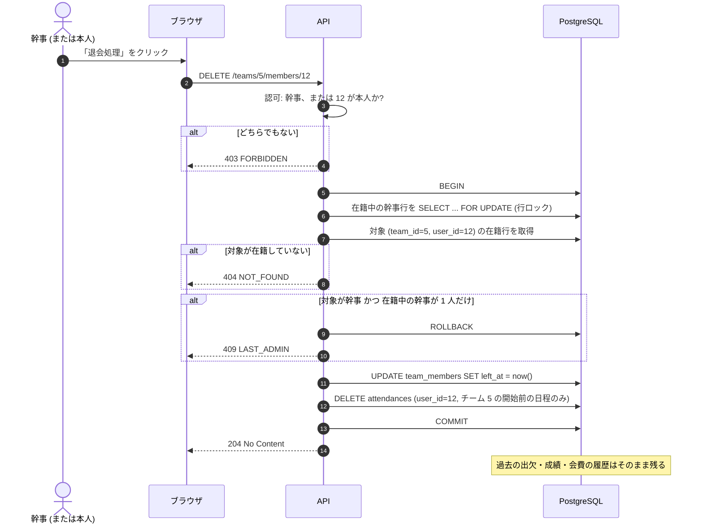

図 14　退会処理の流れ

1. 認可: 呼び出した人が **幹事**、または **対象本人**であること (それ以外は 403)。
2. トランザクションを開始し、そのチームの**在籍幹事の行を `SELECT ... FOR UPDATE` でロック**する (10.1.5 節)。
3. 対象 (team_id, user_id) の在籍行を取得する。なければ 404。
4. 対象が幹事で、在籍幹事がちょうど 1 人なら、ロールバックして 409 LAST_ADMIN。
5. left_at に現在時刻を設定する (role はそのまま)。
6. そのチームの**開始前の日程** (events.starts_at > 現在) に対する、対象ユーザーの出欠 (attendances) を削除する。
7. コミットして 204 を返す。

### 10.1.4 退会後に何が見える・消えるか

| **対象** | **退会後の扱い** |
|---|---|
| **そのチームの画面・API** | 見えない (404)。チーム選択画面の一覧からも消える。 |
| **メンバー一覧** | 在籍者のみ表示。幹事は「退会済みも表示」で確認できる。 |
| **過去の日程の出欠** | 残る。参加者一覧に「退会済み」バッジ付きで表示する。 |
| **これからの日程の出欠** | 退会時に削除する (人数の集計に残らないように)。再参加しても自動では戻らない。 |
| **「未回答」の集計** | 在籍メンバーだけが対象。退会者は含めない。 |
| **試合の出場・得点・アシスト (フェーズ 2)** | 残る。成績では「退会済み」バッジ付きで表示する。 |
| **会費 (フェーズ 2)** | 未払いの請求は残り、請求詳細に「退会済み」バッジ付きで表示する (入金済みにもできる)。新しい請求の対象には選べない。 |
| **招待リンク・日程などの作成者** | 名前は残る。 |
| **アカウント自体** | そのまま (他のチームには所属できる。ログインも可能)。 |

### 10.1.5 状態遷移

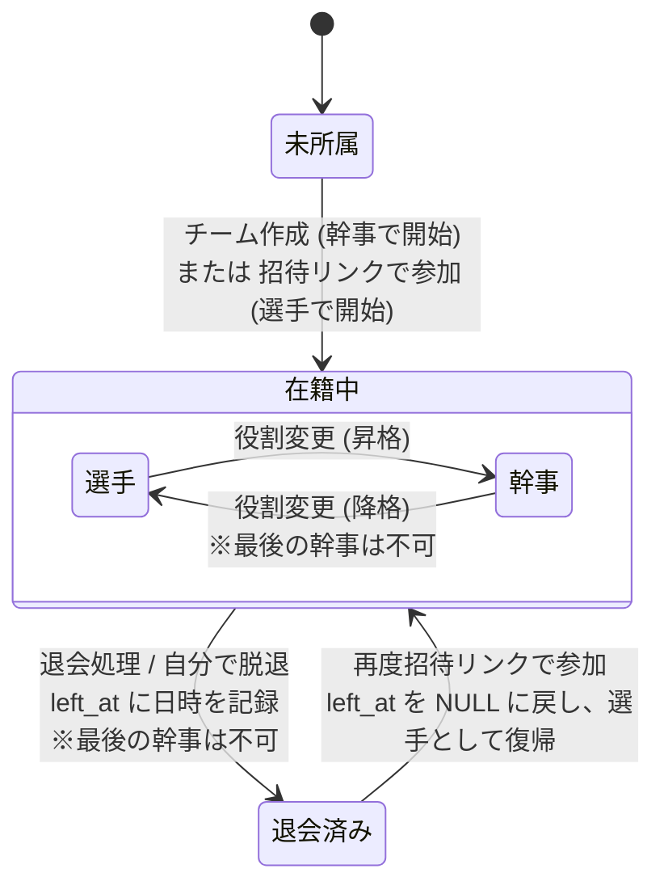

図 15　チームメンバーの状態遷移

> **最後の幹事の保護と「同時操作」**
>
> ルール: チームには常に 1 人以上の幹事がいる。最後の幹事は、降格も退会もできない。
>
> 幹事が A さん・B さんの 2 人で、2 人がほぼ同時に「相手を退会させる」を押したとします。ロックなしでは、両方の処理が「幹事は 2 人いるから大丈夫」と判断して実行し、幹事が 0 人になってしまいます。
>
> 対策として、判定の前にそのチームの在籍幹事の行を SELECT ... FOR UPDATE でロックします。先に来た処理が終わるまで、後の処理は待たされ、後の処理が人数を数えるときには「幹事は 1 人」になっているため 409 になります。役割変更 (降格) でも同じ手順を使います。

### 10.1.6 役割変更のルール

| **操作** | **条件** | **結果** |
|---|---|---|
| 選手 → 幹事 (昇格) | 幹事が行う。 | 常に可。 |
| 幹事 → 選手 (降格) | 幹事が行う。在籍幹事が 2 人以上。 | 可。1 人だけなら 409 LAST_ADMIN。自分自身の降格も、他に幹事がいれば可。 |
| 同じ役割への変更 | - | 何もせず 200。 |
| 退会済み・非所属ユーザーが対象 | - | 404。 |

## 10.2 招待リンク

> **やさしい解説: 招待リンクとは**
>
> 幹事が発行する、「このチームに入れる合言葉つきの URL」です (例: https://.../invite/Zk9x...)。URL の最後の長いランダム文字列 (トークン) が合言葉で、知っている人だけが参加できます。
>
> - **複数の人が同じリンクを使えます** (グループ LINE に 1 本貼れば全員が使える)。
> - 発行から **7 日**で期限切れになります。
> - リンクが外に漏れたときは、幹事が**無効化**して、新しいリンクを発行します。
> - すでに参加した人は、無効化しても影響を受けません。
>
> リンクの状態 (有効 / 期限切れ / 無効化済み) は DB に「状態」として保存せず、expires_at と revoked_at からその都度計算します。時間がたてば自然に期限切れになるため、状態を書き換える処理が要りません。

### 10.2.1 状態と有効条件

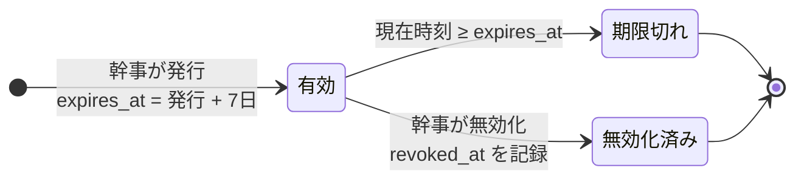

図 16　招待リンクの状態

```python
def is_valid(self, now) -> bool:
    return self.revoked_at is None and self.expires_at > now

def status(self, now) -> str:
    if self.revoked_at is not None: return "revoked"   # 無効化を優先
    if self.expires_at <= now: return "expired"
    return "active"
```

### 10.2.2 トークンの作り方と保存

- secrets.token_urlsafe(32) で生成する。約 256 ビット、43 文字。推測は現実的に不可能。
- DB には**そのまま (平文) 保存**する。幹事が一覧画面で URL を再表示・コピーできるようにするため。
- セッションのトークンはハッシュ化して保存するのに、招待は平文でよい理由: セッションのトークンは「その人になりすませる鍵」だが、招待トークンは「チームに入るだけの権利」で、期限と無効化で守れるため。
- invitations.token に UNIQUE 制約を付ける。

### 10.2.3 発行から確認までの流れ

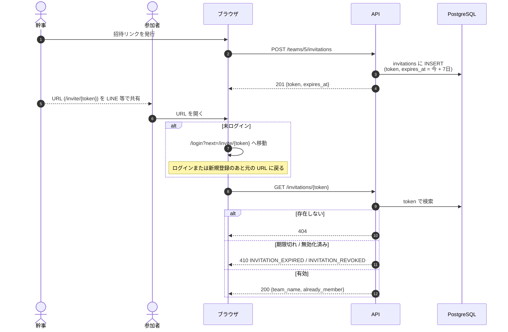

図 17　招待リンクの発行から確認まで

### 10.2.4 参加の流れ

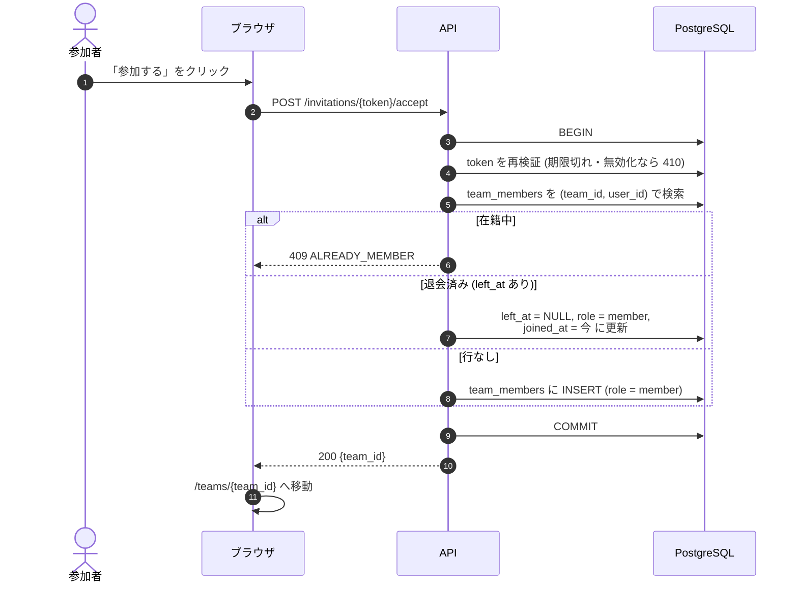

図 18　招待を受けて参加する流れ

### 10.2.5 ケース別の動作

| **ケース** | **動作** |
|---|---|
| **未ログインでリンクを開いた** | /login?next=/invite/{token} へ移動し、ログインまたは新規登録のあとに元のリンクへ戻る。 |
| **ログイン済み・未所属** | 「参加する」で選手として参加。 |
| **すでに在籍中** | 確認画面に「すでに参加しています」を表示。参加 API は 409 ALREADY_MEMBER。 |
| **以前に退会した人** | 再参加できる。left_at を NULL、role を member、joined_at を現在に更新。 |
| **期限切れ / 無効化済み** | 410 (INVITATION_EXPIRED / INVITATION_REVOKED)。 |
| **存在しないトークン** | 404。 |
| **2 人が同時に同じリンクで参加** | どちらも参加できる (人数上限なし)。 |
| **同じ人が 2 回連打** | 2 回目は 409。UNIQUE (team_id, user_id) が最後の砦。 |
| **リンクが漏れた** | 幹事が無効化し、新しいリンクを発行する。 |

補足: どのリンクで誰が参加したかは記録しません (参加日時は team_members.joined_at で分かります)。必要になったら team_members に invitation_id を追加します (第 13 章)。

## 10.3 日程と出欠

### 10.3.1 出欠を回答・変更できるか

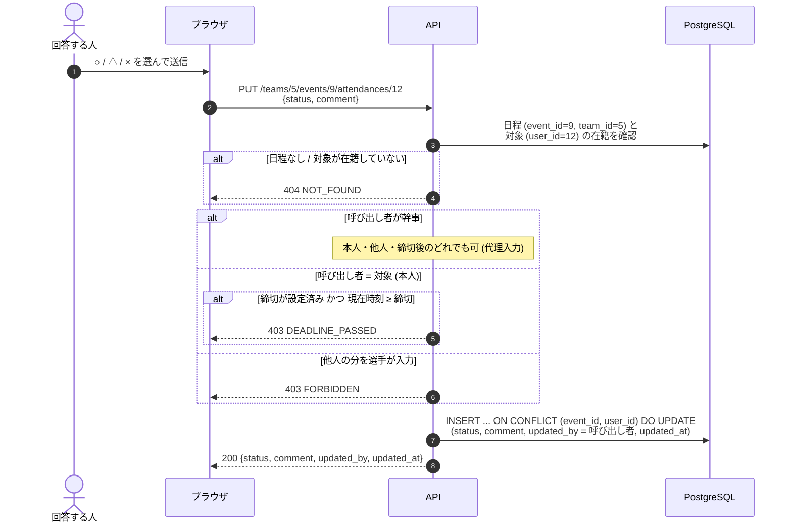

図 19　出欠回答の認可判定の流れ

| **呼び出した人** | **対象** | **締切前 (または締切なし)** | **締切後** |
|---|---|---|---|
| 選手 | 自分 | 可 | 不可 (403 DEADLINE_PASSED) |
| 選手 | 他人 | 不可 (403 FORBIDDEN) | 不可 (403 FORBIDDEN) |
| 幹事 | 自分 | 可 | 可 |
| 幹事 | 他人 (代理入力) | 可 | 可 |

- 締切の判定: attendance_deadline IS NULL OR 現在時刻 < attendance_deadline。**締切ちょうどの時刻は締切済み**として扱う。
- 現在時刻は**サーバーの時計**で判定する (ブラウザの時計は信用しない)。
- 締切が未設定の日程は、いつでも回答できる [現仕様どおり。開始後の扱いは第 13 章]。
- 代理入力・締切後の変更では、updated_by に幹事の ID を入れる。画面には「幹事が入力」と表示する。
- 同じ人が同じ日程に回答しても行は増えない (UNIQUE (event_id, user_id) と UPSERT)。
- 未回答に戻す操作はない (回答は ○ △ × のどれかに変更する)。

### 10.3.2 集計の定義

| **項目** | **定義** |
|---|---|
| **○ / △ / × の人数** | その日程に出欠の行があり、status が attending / undecided / not_attending の人数。 |
| **未回答** | 在籍メンバーのうち、その日程に出欠の行がない人。(在籍メンバー − 回答済み) |
| **退会者の回答** | 過去の日程では行が残るため一覧と人数に含まれ、「退会済み」バッジを付ける。これからの日程では退会時に削除済み。 |
| **日程詳細の「回答できるか」** | can_answer = 幹事、または (締切が未設定 / 現在 < 締切)。 |

- 日程を削除すると、その出欠も一緒に消える (ON DELETE CASCADE)。
- 日程を編集して締切を変更すると、すぐに反映される。すでにある回答には影響しない。
- 日程の team_id は作成後に変更できない。

## 10.4 会費・収支 (フェーズ 2)

> **やさしい解説: 請求 → 入金 → 帳簿**
>
> アプリはお金を動かしません。帳簿 (記録) をつけるだけです。流れは次のとおりです。
>
> 1. 幹事が「11 月分会費 1,000 円」という**請求**を作る。対象メンバーごとに「未払い」の行ができる。
> 2. メンバーが現金などで支払う (アプリの外)。
> 3. 幹事が、その人の行を**「入金済み」**にする。すると**帳簿に収入が 1 行、自動で追加**される。
> 4. 間違えたら「未払いに戻す」。自動で追加した収入の行も一緒に取り消される。
>
> 請求と帳簿を別々に管理すると、「入金済みなのに帳簿に載っていない」といった食い違いが起きます。そのため、入金済みにする処理と帳簿への記録を同じトランザクションで行い、食い違いが起きない作りにします。

### 10.4.1 入金処理

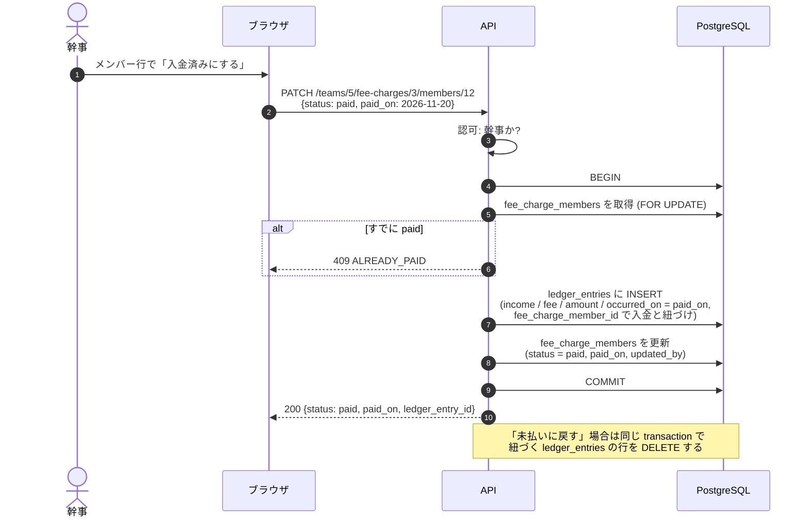

図 20　入金済みにする処理の流れ

### 10.4.2 ルール

| **項目** | **ルール** |
|---|---|
| **金額** | 整数 (円)。1 人あたりの金額は請求の作成時に fee_charge_members.amount にコピーされ、あとから変わらない。 |
| **対象メンバー** | 作成時に選ぶ。作成後の追加・削除はしない。退会者は新規請求の対象外。 |
| **入金済みにする** | status = paid、paid_on を記録、帳簿に収入 (カテゴリ = 会費、発生日 = 入金日) を作る。帳簿の行は fee_charge_member_id で入金と結びつく。 |
| **未払いに戻す** | 紐づく帳簿の行を削除し、status = unpaid、paid_on = NULL に戻す。 |
| **帳簿の行のロック** | 会費入金から作られた行は、帳簿の画面・API からは修正・削除できない (409 LEDGER_ENTRY_LOCKED)。請求の側で未払いに戻す。 |
| **請求の削除** | 入金済みが 1 件でもあれば不可 (409 CHARGE_HAS_PAYMENTS)。 |
| **手動の収支** | 幹事が帳簿に直接追加する (コート代、備品、会費以外の収入など)。何度でも修正・削除できる。 |
| **残高** | (収入の合計) − (支出の合計)。保存せず、その都度集計して求める。 |

### 10.4.3 例

| **できごと** | **請求の状態** | **帳簿** |
|---|---|---|
| 「11 月分会費 1,000 円」を 18 人に請求 | 未払い 18 人 | (なし) |
| 10 人が入金済みになる | 入金 10 人 / 未払い 8 人 | 収入 1,000 円 × 10 行 (計 10,000 円) |
| 幹事がコート代 5,500 円を追加 | (変化なし) | 支出 5,500 円 (1 行) |
| 1 人を未払いに戻す | 入金 9 人 / 未払い 9 人 | 収入が 9 行 (計 9,000 円)、残高 3,500 円 |

## 10.5 試合結果・成績 (フェーズ 2)

### 10.5.1 出場者と出欠の違い

出欠は「参加予定の回答」、出場者は「実際に出場した人」で、別々に記録します。欠席予定だった人が急きょ参加したり、参加予定の人が欠場したりするためです。成績 (出場回数・得点) は、出場者を基準に集計します。結果登録画面では、出欠が ○ の人を初期チェックにして、幹事が調整します。

### 10.5.2 結果の登録ルール

- 種別が「試合」の日程だけ、結果を持てる (1 日程に 1 件)。
- 得点者・アシスト者は、その試合の出場者に含まれること。得点者とアシスト者は別人。
- **得点の記録数は自チームの得点以下**。オウンゴールや記録しない得点があるため、「一致」ではなく「以下」とする。
- 勝敗は、自チーム得点と相手得点の大小で決める (勝 / 分 / 負)。保存はせず、その都度求める。
- 結果を再送信 (PUT) すると、出場者と得点は**全件が入れ替わる**。
- 結果がある日程は、種別の変更・削除ができない。先に結果を削除する。

### 10.5.3 集計の定義

| **項目** | **定義** |
|---|---|
| **期間** | year 指定時は、JST の暦年 (1/1 0:00 〜 翌年 1/1 0:00) に開始する日程の試合が対象。DB の比較は UTC に直して行う。省略時は全期間。 |
| **出場回数** | 期間内の試合のうち、match_participants に含まれる件数。 |
| **得点 / アシスト** | match_goals の得点者 / アシスト者としての件数。 |
| **順位** | 得点の多い順。同数は同順位 (RANK())。得点が同じ場合は出場回数の多い順に並べる (順位は同じ)。 |
| **退会者** | 集計に含め、「退会済み」バッジを付ける。 |
| **チーム戦績** | 期間内の試合数、勝・分・負、総得点、総失点。 |

### 10.5.4 集計クエリの例

```sql
-- 選手別成績 (得点・アシスト・出場回数・得点順位)
WITH app AS (
  SELECT mp.user_id, COUNT(*) AS appearances
  FROM match_participants mp
  JOIN matches m ON m.id = mp.match_id
  JOIN events e ON e.id = m.event_id
  WHERE e.team_id = :team_id AND e.starts_at >= :from AND e.starts_at < :to
  GROUP BY mp.user_id
), goal AS (
  SELECT mg.scorer_user_id AS user_id, COUNT(*) AS goals
  FROM match_goals mg
  JOIN matches m ON m.id = mg.match_id
  JOIN events e ON e.id = m.event_id
  WHERE e.team_id = :team_id AND e.starts_at >= :from AND e.starts_at < :to
  GROUP BY mg.scorer_user_id
), assist AS (
  SELECT mg.assist_user_id AS user_id, COUNT(*) AS assists
  FROM match_goals mg
  JOIN matches m ON m.id = mg.match_id
  JOIN events e ON e.id = m.event_id
  WHERE e.team_id = :team_id AND e.starts_at >= :from AND e.starts_at < :to
    AND mg.assist_user_id IS NOT NULL
  GROUP BY mg.assist_user_id
)
SELECT u.id, u.name, (tm.left_at IS NOT NULL) AS is_former_member,
       app.appearances,
       COALESCE(goal.goals, 0) AS goals,
       COALESCE(assist.assists, 0) AS assists,
       RANK() OVER (ORDER BY COALESCE(goal.goals, 0) DESC) AS goal_rank
FROM app
JOIN users u ON u.id = app.user_id
JOIN team_members tm ON tm.user_id = u.id AND tm.team_id = :team_id
LEFT JOIN goal ON goal.user_id = u.id
LEFT JOIN assist ON assist.user_id = u.id
ORDER BY goals DESC, app.appearances DESC, u.id;

-- チーム戦績
SELECT COUNT(*) AS played,
       COUNT(*) FILTER (WHERE m.our_score > m.opponent_score) AS wins,
       COUNT(*) FILTER (WHERE m.our_score = m.opponent_score) AS draws,
       COUNT(*) FILTER (WHERE m.our_score < m.opponent_score) AS losses,
       COALESCE(SUM(m.our_score), 0) AS goals_for,
       COALESCE(SUM(m.opponent_score), 0) AS goals_against
FROM matches m JOIN events e ON e.id = m.event_id
WHERE e.team_id = :team_id AND e.starts_at >= :from AND e.starts_at < :to;
```

## 10.6 お知らせ・助っ人・フォーメーションボード (フェーズ 3)

### 10.6.1 お知らせ

- チーム単位。投稿・編集・削除は幹事、閲覧は在籍メンバー。
- ピン留めされたお知らせは一覧の先頭。ピン留めの数に上限は設けない。
- 本文はプレーンテキスト。HTML としては解釈しない。改行だけを反映する。
- 既読管理・通知はしない (第 13 章)。

### 10.6.2 助っ人 (ゲスト)

- 助っ人はチームに属する名前 (アカウントなし)。1 度登録すれば、複数の日程で使い回せる。
- 助っ人の出欠は、attendances の guest_id で持つ。user_id と guest_id のどちらか一方だけが入る。
- 助っ人の出欠は幹事だけが入力・削除する。締切の制限はかからない。
- 日程詳細では選手と区別して「助っ人」バッジを付ける。○ の合計 (attending_total) は選手の ○ と助っ人の ○ の合計。「未回答」は選手だけが対象。
- 助っ人の**成績は記録しない** (出場者・得点者・アシスト者になれるのは選手のみ)。ただしチームの得点には含まれる (our_score)。
- 出欠・フォーメーションに使われている助っ人は削除できない。

### 10.6.3 フォーメーションボード

- 種別が「試合」の日程に 1 つ。選手の座標と、スタメン / ベンチを保存する。
- 座標はピッチを 100 × 100 とした割合 (左上が原点)。ピッチの種類 (サッカー / フットサル) を持つ。
- 保存は全件置き換え (PUT)。スタメンの上限はサッカー 11 人、フットサル 5 人。
- 候補に出す人は、出欠が ○ または △ の選手と、○ の助っ人 (画面側の絞り込み。API は在籍メンバーであれば受け付ける)。
- 日程を削除するとボードも消える (CASCADE)。

# 11. 非機能要件

## 11.1 時刻の扱い [暫定]

| **場面** | **決まり** |
|---|---|
| **DB への保存** | 日時は timestamptz (内部は UTC)。日付のみの項目 (due_on, paid_on, occurred_on) は date で、JST の日付として扱う。 |
| **API の入出力** | 日時は ISO 8601 の UTC (末尾 Z)。日付は YYYY-MM-DD。 |
| **画面の表示・入力** | 日本時間 (Asia/Tokyo) 固定。入力された日時は、フロントで UTC に変換して送る。 |
| **「今日」「今年」の判定** | サーバーで ZoneInfo("Asia/Tokyo") を使って決める (例: 日程一覧の既定の開始位置、成績の year、入金日の既定値)。 |
| **現在時刻** | サーバーの時刻 (UTC) を使う。ブラウザの時計は使わない。テストでは時刻を差し替えられるようにする (現在時刻を返す関数を 1 か所に用意する)。 |

国内のチームのみを想定した仮置きです。海外の利用やチームごとのタイムゾーンが必要になったら、teams にタイムゾーン列を追加する方向で見直します (第 13 章)。

## 11.2 入力検証

検証は Pydantic (入口) と DB の CHECK 制約 (最後の砦) の 2 段で行います。文字列は前後の空白を除いてから長さを調べます。

| **対象** | **項目** | **ルール** |
|---|---|---|
| ユーザー | name / email / password | 1〜50 文字 / メール形式・254 文字以内・小文字化 / 8〜128 文字 |
| チーム | name | 1〜50 文字 |
| 日程 | type / title | match practice other / 1〜100 文字 |
| 日程 | starts_at / ends_at / attendance_deadline | ends_at は starts_at より後。attendance_deadline は starts_at 以前。 |
| 日程 | location / note | 200 文字以内 / 2000 文字以内 |
| 出欠 | status / comment | attending undecided not_attending / 200 文字以内 |
| 請求 (2) | title / amount_per_member / note | 1〜100 文字 / 1〜1,000,000 の整数 / 500 文字以内 |
| 請求 (2) | paid_on | 未来の日付は不可 |
| 帳簿 (2) | amount / category / memo | 1〜10,000,000 の整数 / fee court equipment other / 200 文字以内 |
| 試合結果 (2) | opponent / スコア / note | 1〜100 文字 / 0〜99 の整数 / 1000 文字以内 |
| 試合結果 (2) | goals.minute | 1〜150 の整数 (任意) |
| お知らせ (3) | title / body | 1〜100 文字 / 1〜5000 文字 |
| 助っ人 (3) | name / note | 1〜50 文字 / 200 文字以内 |
| ボード (3) | x / y / formation_name / label | 0〜100 / 20 文字以内 / 10 文字以内 |

## 11.3 マイグレーション (Alembic)

- テーブルの作成・変更はすべて Alembic のリビジョンで行う。手作業で DB を直さない。
- フェーズごとにリビジョンを分ける (例: 0001_phase1_initial、0002_phase2_fees_matches、0003_phase3_guests_board)。
- フェーズ 3 の attendances の変更 (user_id を NULL 可に、guest_id と CHECK・UNIQUE を追加) は、既存データがそのまま制約を満たすため、データ移行は不要。
- 列挙値は文字列 + CHECK のため、値の追加は「CHECK 制約の作り直し」で済む。
- backend の起動時に alembic upgrade head を実行する。
- 初期データ (シード) は用意しない。開発用のダミーデータは別スクリプトにする。

## 11.4 テスト方針

pytest と FastAPI の TestClient、テスト専用の DB (トランザクションのロールバックで毎回まっさらにする) を使います。認可と業務ルールを重点的にテストします。

| **分類** | **主なテストケース** | **期待** |
|---|---|---|
| 認証 | 登録後にログイン状態になる / メール重複 / 誤ったパスワード / 存在しないメール | 201 / 409 / 401 (同じメッセージ) / 401 (同じメッセージ) |
| 認証 | Cookie なし / 期限切れセッション / ログアウト後の同じトークン | 401 |
| 認可 | 他チームの team_id で全 API を呼ぶ | 404 (403 ではない) |
| 認可 | 選手が幹事専用 API を呼ぶ | 403 |
| 認可 | 日程 ID だけ別チームのものを指定 | 404 |
| 退会 | 最後の幹事の退会 / 降格 | 409 LAST_ADMIN |
| 退会 | 退会後にチーム API を呼ぶ / 退会後に再度招待で参加 | 404 / 再参加でき、選手になる |
| 退会 | 退会時に将来の出欠だけが消え、過去の出欠は残る | データで確認 |
| 退会 | 幹事 2 人が同時に相手を退会 (並行実行) | 片方だけ成功、もう片方は 409 |
| 招待 | 期限切れ / 無効化済み / 存在しないトークン / 在籍中の人 | 410 / 410 / 404 / 409 |
| 招待 | 同じリンクで複数人が参加 | 全員参加できる |
| 出欠 | 締切前の本人 / 締切後の本人 / 締切後の幹事 / 選手が他人の分 | 200 / 403 / 200 / 403 |
| 出欠 | 締切の境界 (ちょうど締切時刻) | 締切済み (403) |
| 出欠 | 日程一覧の集計と未回答の人数 | 期待値と一致、クエリ数が日程数に比例しない |
| 会費 (2) | 入金済み → 帳簿に収入 / 未払いに戻す → 収入が消える | トランザクションで両方反映 |
| 会費 (2) | 自動記録された帳簿の行を修正・削除 | 409 LEDGER_ENTRY_LOCKED |
| 成績 (2) | 得点の記録数 > 自チーム得点 / 出場者以外の得点者 | 422 |
| 成績 (2) | 同数得点の順位 | 同順位 (1, 1, 3) |
| 助っ人 (3) | user_id と guest_id の両方、または両方なし | DB の CHECK で拒否 |

## 11.5 ログとエラー処理

- パスワード、トークン (Cookie の値・招待トークン)、password_hash をログに出さない。
- アプリで想定したエラーは AppError(status, code, message) を送出し、例外ハンドラで共通のエラー JSON に変換する。
- 想定外の例外は 500 INTERNAL_ERROR。詳細はサーバーのログだけに記録し、レスポンスには出さない。
- リクエストログには、メソッド・パス・状態コード・処理時間・ユーザー ID を出す。

## 11.6 性能と規模の想定

- 1 チーム 10〜50 人、1 年に 100 件程度の日程を想定する。大規模な負荷対策は不要。
- 一覧 API で日程ごとにクエリを繰り返す (N+1) ことはしない。出欠の集計は GROUP BY で一括取得する。
- 一覧にはページング (limit / offset) を付ける。
- 「インデックスを付けた列で引く」(7.6.2 節) ことだけ守れば、この規模では十分。

## 11.7 動作環境

- 利用者: PC の最新の Chrome / Edge / Safari / Firefox。
- 開発: Docker Compose で db / backend / frontend を起動する (docker compose up --build)。画面は http://localhost:3000、API は http://localhost:8000 (FastAPI の自動ドキュメントは /docs)。

# 12. 開発の進め方

## 12.1 フェーズ 1 (MVP) の実装順序

サーバー側を学ぶ目的に合わせ、「API とテストを先に作り、そのあと画面をつなぐ」順序を推奨します。1 ステップごとに動作確認できる大きさにしています。

| **ステップ** | **内容** | **完了の目安** | **主に学ぶこと** |
|---|---|---|---|
| 0 環境 | Docker Compose、DB 接続、Alembic の初期化、エラー形式 (AppError)、設定の読み込み | /docs が開き、空のマイグレーションが通る | Compose、設定、例外ハンドラ |
| 1 認証 | users / sessions、登録・ログイン・ログアウト・/me、Cookie、CORS、Origin 検査 | Cookie でログイン状態が保たれ、ログアウトで 401 になる | ハッシュ、セッション、Cookie、CORS・CSRF |
| 2 チーム | teams / team_members、チーム作成・一覧・詳細、get_team_context、require_admin | 他チームの ID で 404、選手で 403 になる | 認可の依存関数、404 方針 |
| 3 メンバー | メンバー一覧、役割変更、退会処理、最後の幹事の保護 | 同時実行テストで幹事が 0 人にならない | トランザクション、行ロック、論理削除 |
| 4 招待 | invitations、発行・一覧・無効化、確認・参加、再参加 | 期限切れ・無効化・再参加が期待どおり | 乱数トークン、状態の計算、UPSERT 的な処理 |
| 5 日程 | events、一覧 (期間絞り込み・ページング)・作成・詳細・更新・削除 | 部分更新で前後関係が再検証される | 部分更新、入力検証、日時 |
| 6 出欠 | attendances、回答・代理入力・締切判定、集計 (N+1 なし) | 4.5 節と 10.3 節のとおりに判定される | UPSERT、集計クエリ |
| 7 画面 | 全画面を実装し、API につなぐ。ログイン後の遷移、next、確認ダイアログ | 6 章の画面が一通り操作できる | Next.js、認証状態の扱い |
| 8 仕上げ | テストの補強、エラー表示の確認、README、ドキュメントの更新 | 11.4 節のケースがすべて通る | テスト設計 |

## 12.2 フェーズ 2 の実装順序

| **ステップ** | **内容** | **完了の目安** |
|---|---|---|
| 1 試合結果 | matches / match_participants / match_goals、結果の取得・登録 (PUT)・削除、日程の更新・削除への制約 (409) | 整合性の検証 (得点数、出場者) が通る |
| 2 成績 | チーム戦績・選手別成績の集計クエリ、year の JST 境界、RANK() | 同数順位が正しい。退会者が含まれる |
| 3 帳簿 | ledger_entries、一覧・追加・修正・削除・集計、ロックの判定 | 集計がページング件数に依存しない |
| 4 会費 | fee_charges / fee_charge_members、請求作成・一覧・詳細・編集・削除、入金・未払い戻し (帳簿と同一トランザクション) | 入金と帳簿が常に一致する |
| 5 画面 | 自分の会費、会費請求、収支帳簿、結果登録、成績、ホーム・日程詳細の追加表示 | 6.5 節・6.7 節の画面が操作できる |

## 12.3 フェーズ 3 の実装順序

| **ステップ** | **内容** | **完了の目安** |
|---|---|---|
| 1 お知らせ | announcements、CRUD、ピン留め、ホームの最新 3 件 | 選手は閲覧のみ |
| 2 助っ人 | guests、attendances の変更 (マイグレーション)、助っ人の出欠、日程詳細の拡張 | 既存の出欠 API が壊れない。CHECK が効く |
| 3 ボード | formation_boards / formation_positions、取得・保存・削除、ドラッグ操作の画面 | スタメン人数の上限・座標の検証が通る |

## 12.4 完了の定義 (各ステップ共通)

- API: 正常系と、主なエラー (401 / 403 / 404 / 409 / 422) のテストがある。
- DB: Alembic のリビジョンがあり、upgrade / downgrade が通る。
- 認可: 「他チーム」「選手」のケースのテストがある。
- 仕様書: 変更があれば、この文書も更新する。

# 13. 未決事項・将来候補

## 13.1 実装前に確認したい事項

| **項目** | **現在の扱い** | **確認したいこと** |
|---|---|---|
| 時刻 [暫定] | DB は UTC、表示・日付境界は JST 固定。 | 海外・別タイムゾーンでの利用の予定がないか。 |
| 締切未設定のとき | 開始後も含め、いつでも回答できる (現仕様どおり)。 | 「開始時刻を過ぎたら選手は回答不可」にするか。 |
| 日程の繰り返し登録 [採用案] | フェーズ 1〜3 に含めない。 | 毎週の練習を一括で作る機能が必要になる時期。 |
| 出欠の取り消し | できない (○ △ × の変更のみ)。 | 幹事が「未回答に戻す」操作を必要とするか。 |
| 再参加時の役割 | 常に選手に戻る。 | 以前の役割を覚えておく必要があるか。 |

## 13.2 将来の候補 (今回は対象外)

| **候補** | **概要・設計の見通し** |
|---|---|
| **日程の繰り返し登録** | events に recurrence_group_id を持たせ、毎週の日程をまとめて生成する。 |
| **ログイン試行の回数制限** | 同一メール・同一 IP で失敗が続いたら一時ロック。 |
| **パスワードリセット・メール確認** | メール送信基盤が必要。トークン付き URL の仕組みは招待リンクと近い。 |
| **全端末ログアウト・セッション一覧** | sessions の行を全削除 / 一覧表示するだけで実現できる。 |
| **チーム名の変更・チーム削除、プロフィール編集、アカウント削除** | 削除はデータの扱い (履歴の匿名化など) の設計が要る。 |
| **招待経由の記録** | team_members.invitation_id を追加して、どのリンクで参加したかを残す。 |
| **お知らせの既読管理・通知** | 既読テーブル、メール / LINE 通知。 |
| **助っ人の成績** | 出場者・得点者に guest_id を持たせる。 |
| **会費の一部入金・返金・領収** | 入金の履歴テーブルを持たせる。 |
| **監査ログ** | 誰がいつ何を変更したかを記録する。 |
| **チーム内の複数コート・複数チーム運用** | 現在は 1 チーム = 1 運営単位。 |

# 付録 A. エラーコード一覧

| **code** | **HTTP** | **意味** | **主な発生箇所** |
|---|---|---|---|
| UNAUTHENTICATED | 401 | ログインしていない / セッション切れ | 認証が必要なすべての API |
| INVALID_CREDENTIALS | 401 | メールかパスワードが違う | POST /auth/login |
| FORBIDDEN | 403 | この操作の権限がない | 幹事専用 API、他人の出欠入力、include_left |
| DEADLINE_PASSED | 403 | 出欠の締切を過ぎている | PUT .../attendances/{uid} |
| CSRF_ORIGIN_MISMATCH | 403 | Origin が許可されていない | 書き込み系すべて |
| NOT_FOUND | 404 | 存在しない、または見せない | チーム・日程などの取得、トークン |
| EMAIL_ALREADY_REGISTERED | 409 | メールが登録済み | POST /auth/signup |
| ALREADY_MEMBER | 409 | すでに在籍中 | POST /invitations/{token}/accept |
| LAST_ADMIN | 409 | 最後の幹事は降格・退会できない | 役割変更、退会処理 |
| ALREADY_PAID / ALREADY_UNPAID | 409 | 入金状況がすでに同じ | PATCH .../fee-charges/.../members/{uid} |
| CHARGE_HAS_PAYMENTS | 409 | 入金済みがあるため請求を削除できない | DELETE .../fee-charges/{id} |
| LEDGER_ENTRY_LOCKED | 409 | 会費入金から作られた行は編集できない | 帳簿の PATCH / DELETE |
| EVENT_HAS_RESULT | 409 | 結果がある日程は変更・削除できない | 日程の PATCH (種別変更) / DELETE |
| GUEST_IN_USE | 409 | 使用中の助っ人は削除できない | DELETE .../guests/{id} |
| INVITATION_EXPIRED | 410 | 招待リンクの期限切れ | 招待の確認・参加 |
| INVITATION_REVOKED | 410 | 招待リンクが無効化済み | 招待の確認・参加 |
| VALIDATION_ERROR | 422 | 入力が不正 (details に項目別) | 入力を受けるすべての API |
| EVENT_NOT_MATCH | 422 | 種別が「試合」ではない日程 | 試合結果・ボードの PUT |
| INTERNAL_ERROR | 500 | 想定外のエラー | - |

# 付録 B. 列挙値の一覧

| **種類** | **保存値** | **画面の表示** | **使うテーブル** |
|---|---|---|---|
| 役割 | admin / member | 幹事 / 選手 | team_members.role |
| 日程の種別 | match / practice / other | 試合 / 練習 / その他 | events.type |
| 出欠 | attending / undecided / not_attending | ○ / △ / × | attendances.status |
| 招待の状態 (計算) | active / expired / revoked | 有効 / 期限切れ / 無効化済み | (API で計算して返す) |
| 入金状況 | unpaid / paid | 未払い / 入金済み | fee_charge_members.status |
| 収支の種別 | income / expense | 収入 / 支出 | ledger_entries.type |
| 収支のカテゴリ | fee / court / equipment / other | 会費 / コート代 / 備品 / その他 | ledger_entries.category |
| 試合の結果 (計算) | win / draw / lose | 勝 / 分 / 負 | (API で計算して返す) |
| ピッチの種類 | soccer / futsal | サッカー / フットサル | formation_boards.pitch_type |
